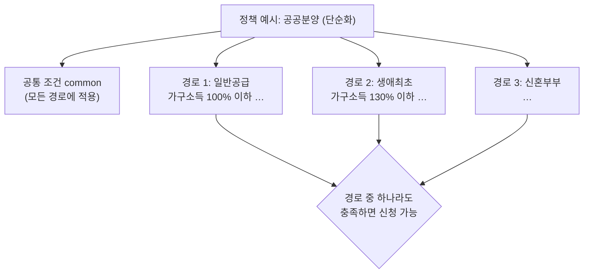
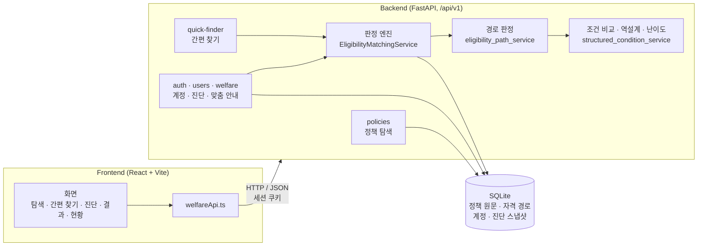
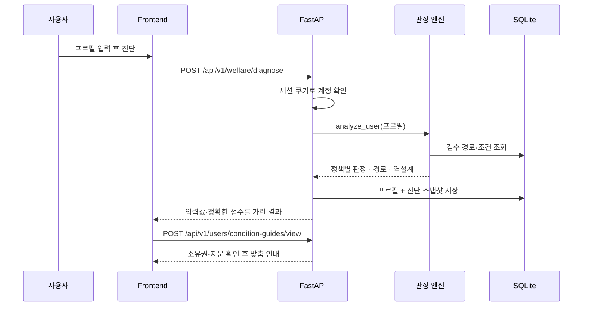
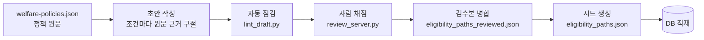

<div align="center">


### 내가 받을 수 있는 청년 정책, 안 된다면 무엇이 바뀌면 되는지까지

청년이 자신의 상황을 입력하면 복지 정책마다 **신청 가능 · 확인 필요 · 신청 불가**를 판정하고,<br>
안 되는 정책은 어떤 조건이 어떻게 바뀌면 되는지 **역설계**해서 안내하는 웹 서비스입니다.


</div>

---

## 목차

1. [개발 배경과 목적](#개발-배경과-목적)
2. [주요 기능](#주요-기능)
3. [서비스 화면](#서비스-화면)
4. [기술 스택](#기술-스택)
5. [시스템 구조와 데이터 흐름](#시스템-구조와-데이터-흐름)
6. [핵심 기술과 차별점](#핵심-기술과-차별점)
7. [디렉터리 구조](#디렉터리-구조)
8. [로컬 실행](#로컬-실행)
9. [팀 구성](#팀-구성)
10. [개발 현황과 향후 계획](#개발-현황과-향후-계획)
11. [관련 문서](#관련-문서)

---

## 개발 배경과 목적

청년 정책은 수가 많고, 한 정책 안에서도 **유형·순위·대상별로 자격 조건이 다른 경우**가 많습니다. 예를 들어 공공분양은 일반·생애최초·신혼부부 유형마다 소득 기준이 다르고, 어떤 지원은 수급자이거나 등록 장애인 중 차상위인 경우에만 해당합니다. 공고문을 직접 읽고 내 상황과 하나씩 맞춰 보기는 어렵고, 대부분의 조회 서비스는 "해당 / 비해당"만 알려 줄 뿐 **왜 안 되는지, 무엇이 달라지면 되는지**는 알려 주지 않습니다.

자격있청은 다음 세 가지를 목표로 합니다.

| 목표 | 내용 |
| --- | --- |
| 정확한 사전 판정 | 사람이 검수한 정책 조건으로 입력값을 비교해 3단계로 판정합니다. 신청할 수 있는 사람을 "불가"로 잘못 판정하지 않는 것을 가장 중요한 원칙으로 둡니다. |
| 이유가 보이는 결과 | 충족 · 미충족 · 추가 확인 조건을 신청 경로별로 나누어 보여 주고, 원문 근거 구절을 함께 남깁니다. |
| 다음 행동 안내 | 미충족 조건마다 정책 기준과 필요한 변화를 안내하고, 여러 신청 경로 중 상대적으로 쉬운 경로를 추천합니다. |

> **안내** 결과의 "신청 가능"은 입력값과 수집된 정책 기준을 바탕으로 판정 엔진이 계산한 **사전 안내**입니다. 행정적으로 자격이 확정되었다는 뜻이 아니며, 최종 자격은 공식 공고와 담당 기관에서 확인해야 합니다.

---

## 주요 기능

| 기능 | 설명 | 로그인 |
| --- | --- | :---: |
| 정책 탐색·검색 | 키워드와 9개 분야(주거, 취업·일자리, 금융·자산 등)로 정책을 찾고 원문·지원 내용·신청 정보를 확인 | 불필요 |
| 간편 정책 찾기 | 분야를 고르고 버튼으로 몇 가지 질문에 답하면 그 분야 정책을 바로 판정 | 불필요 |
| 자격 진단 | 만 19~34세 청년이 기본·추가 정보를 입력해 전체 정책을 판정하고 결과를 계정에 저장 | 필요 |
| 경로별 판정 | 공통 조건과 여러 대안 신청 경로를 비교해 정책별 3단계 판정 | 필요 |
| 역설계 안내 | 미충족·미확인 조건마다 기준과 필요한 변화를 안내 | 필요 |
| 경로 추천·정렬 | 개선 난이도 점수와 사용자가 정한 가중치로 추천 경로를 정렬 | 필요 |
| 나의 현황·관심 정책 | 최신 현황 재조회, 이전 결과 비교, 관심 정책 저장·진행 상태·메모 | 필요 |

### 1. 정책 탐색과 검색

로그인 없이 정책 목록을 검색하고 분야별로 걸러 볼 수 있습니다. 상세 화면에서는 지원 대상·선정 기준 원문, 지원 내용, 신청 방법, 문의처를 보여 줍니다. 공개 API(`GET /api/v1/policies`)는 개인정보나 진단 결과를 반환하지 않으며, 요청마다 외부 공공 API를 호출하지 않고 수집해 둔 데이터를 읽습니다.

### 2. 간편 정책 찾기 (비로그인, 버튼형)

회원가입 전에 가볍게 써 볼 수 있는 기능입니다. 화면 오른쪽 아래의 말풍선 대화창 또는 전체 화면(`#quick`)에서 이용할 수 있습니다.


- **질문 자동 구성**: 고른 분야의 검수된 경로 조건을 읽어, 그 분야 정책이 실제로 비교하는 항목만 질문합니다. 질문마다 "이 분야 정책 N개가 이 조건을 봐요"처럼 영향 범위를 함께 보여 줍니다.
- **같은 판정 엔진 사용**: 새 판정 규칙을 만들지 않고 자격 진단과 같은 엔진(`EligibilityMatchingService`)으로 평가한 뒤 분야로만 걸러 냅니다.
- **건너뛴 질문은 추정하지 않음**: 답하지 않은 항목에 기본값을 채우지 않으므로, 그 조건은 결과에서 "확인 필요"로 남습니다.
- **저장하지 않음**: 계정·프로필·진단 기록을 만들지 않습니다. 입력값과 결과는 화면 메모리에만 있고, 응답에서도 입력값과 정확한 난이도 점수를 가립니다.
- **현재는 LLM 없이 동작**: 자유 문장 입력이나 AI 답변은 없으며, 미리 정한 질문과 버튼으로만 진행합니다.

관련 코드: [quick_finder_service.py](backend/app/services/quick_finder_service.py) · [QuickFinderPage.tsx](frontend/src/features/quick/QuickFinderPage.tsx) · [QuickChatWidget.tsx](frontend/src/features/quick/QuickChatWidget.tsx)

### 3. 자격 진단

로그인한 사용자가 단계별 입력 화면에서 나이·지역·소득·고용·가구·주거·재산·학업·혼인·자녀·수급 여부 등을 입력합니다. 필수 항목 외에는 선택 입력이며, 입력하지 않은 조건은 "확인 필요"로 처리합니다. 진단 결과는 계정에 저장되어 **진단 결과** 화면과 **나의 현황** 화면에서 다시 볼 수 있습니다.

### 4. 검수된 조건 기반의 경로별 판정

하나의 정책을 **여러 신청 경로(OR)** 와 **경로마다의 조건(AND)** 으로 표현합니다. 모든 경로에 공통인 조건은 `common`으로 따로 둡니다.



| 단위 | 판정 규칙 |
| --- | --- |
| 조건 | 충족 / 미충족 / 확인 필요(미입력·비교 불가) |
| 경로 | 미충족이 하나라도 있으면 **불가**, 미충족 없이 충족이 하나라도 있으면 **가능**, 둘 다 없으면 **확인 필요** |
| 정책 | 가능한 경로가 하나라도 있으면 **가능**, 모든 경로가 불가면 **불가**, 그 밖은 **확인 필요** |

서류·심사처럼 입력으로 비교할 수 없는 사항(`checks`)은 판정을 바꾸지 않고 "추가 확인"으로 따로 안내합니다. 결과 카드는 미충족 · 추가 확인 · 충족 탭으로 나뉘며, 대표 경로를 크게 보여 주고 나머지 경로는 "다른 경로 확인하기"에 접어 둡니다.

### 5. 역설계 안내

신청 불가인 정책에 대해 "무엇이 어떻게 바뀌면 되는지"를 조건별로 안내합니다.

- 저장값을 원문 표현으로 되돌려 보여 줍니다. (예: `2,699,999원 이하` → "270만원 미만")
- 나이 상한 초과처럼 **시간이 지나도 다시 충족할 수 없는 조건**은 바꿀 수 있다고 안내하지 않고, 그런 경로는 다른 가능한 경로가 있을 때 화면에서 숨깁니다.
- 성별·장애·한부모·수급 같은 **대상자 조건**은 "바꾸면 충족"이 아니라 "이 경로는 ○○가 대상"이라는 정보로 안내합니다.
- 소득·고용·거주 기준의 차이를 보여 주는 것과 퇴사·이사·소득 감소를 권하는 것을 구분합니다.

### 6. 난이도 가중치 기반 경로 추천

미충족 조건마다 개선 난이도 점수를 매기고, 합이 가장 낮은 경로를 추천합니다. 사용자는 결과 화면의 **"추천 기준 보기·바꾸기"** 에서 조건 종류별 배율(0.25 · 0.5 · 1 · 2 · 4배)을 바꿀 수 있습니다. 가중치는 화면의 추천 순서에만 영향을 주며 **판정 결과는 바뀌지 않습니다.** 이 점수는 비교용 지표이며 승인 가능성이나 실제 비용을 평가한 값이 아닙니다.

### 7. 로그인 기반 맞춤 안내와 개인정보 보호

| 보호 장치 | 동작 |
| --- | --- |
| 계정·세션 | 비밀번호는 salt가 있는 PBKDF2 해시, 세션 토큰은 해시로 저장하고 원본은 HttpOnly 쿠키로만 전달 |
| 맞춤 안내 전용 API | 로그인 세션과 진단 소유권을 확인한 뒤에만 "기준과 얼마나 차이 나는지" 같은 수치 안내와 정확한 난이도 점수를 제공 (`POST /api/v1/users/condition-guides/view`) |
| 진단 당시 조건 검증 | 진단 당시 정책 원문·조건·계산 코드의 지문(SHA-256)을 저장해 두고, 현재와 다르면 맞춤 안내를 생략하고 저장된 판정만 유지 |
| 일반 응답 마스킹 | 일반 결과 응답에서는 입력값과 정확한 점수를 숨기고, 신규 스냅샷에는 정확한 점수를 저장하지 않음 |
| 프로필 열람 | 저장된 전체 프로필을 볼 때는 아이디·비밀번호로 다시 본인 확인 |
| 브라우저 | API 응답에 `Cache-Control: no-store`, 맞춤 안내는 메모리에만 두고 로그아웃·계정 전환·화면 이탈 시 비움 |

---

## 서비스 화면

| 화면 | 경로 | 주요 내용 |
| --- | --- | --- |
| 홈 | `#home` | 서비스 소개, 간편 정책 찾기 진입 |
| 정책 찾기 | `#explorer`, `#detail/{id}` | 검색·분야 필터, 정책 상세 |
| 간편 정책 찾기 | `#quick` 또는 오른쪽 아래 대화창 | 분야 선택 → 버튼 질문 → 결과 |
| 자격 진단 | `#diagnosis` | 단계별 프로필 입력 |
| 진단 결과 | `#result` | 정책별 판정, 경로 카드, 역설계, 추천 기준 설정 |
| 나의 현황 | `#dashboard` | 최신 현황 재조회, 이전 결과 비교, 관심 정책 관리 |

<!-- 스크린샷은 개인정보·테스트 계정이 보이지 않는 화면으로 추가 예정입니다. -->

---

## 기술 스택

| 구분 | 사용 기술 |
| --- | --- |
| Frontend | React 19, TypeScript 5, Vite 8, Tailwind CSS 4, 해시 기반 라우팅 |
| Backend | Python 3.10+, FastAPI, Uvicorn, Pydantic 2, pydantic-settings |
| Database | SQLite, SQLAlchemy 2 |
| 테스트 | pytest (백엔드), Node.js 내장 테스트 러너 (프론트엔드) |
| 데이터 관리 | Git LFS (정책 적재 SQLite·이미지), JSON 시드 |
| 패키지 관리 | pip (`requirements.txt`), pnpm 또는 npm (`package.json`) |

의존성 버전은 [backend/requirements.txt](backend/requirements.txt)와 [frontend/package.json](frontend/package.json)을 기준으로 합니다.

---

## 시스템 구조와 데이터 흐름

### 전체 구조



### 자격 진단 요청 흐름



### 정책 데이터 검수 파이프라인



정책 원문이 바뀌면(원문 해시 불일치) 해당 정책은 시드에서 빠지고 재검수 대상이 됩니다. 실행 중에도 DB 원문 해시가 맞지 않으면 그 정책은 경로 판정 대신 이전 분석을 사용합니다.

---

## 핵심 기술과 차별점

**1. 잘못된 "불가"를 만들지 않는 보수적 판정**
신청할 수 있는 사람이 "불가"로 나오는 오류를 가장 먼저 막습니다. 입력하지 않았거나 비교할 수 없는 조건은 "확인 필요"로 두고, 비교 조건이 없는 경로가 정책 전체를 "불가"로 만들지 않도록 설계했습니다.

**2. OR 경로 + AND 조건 구조**
유형·순위·예외 대상별로 기준이 다른 정책을 하나의 조건 목록으로 뭉개지 않고 경로로 나누어 표현합니다. 도입 당시 10개 정책 × 5개 테스트 프로필 비교에서 기존 구조는 49/50, 경로 구조는 50/50으로 기대 결과와 일치했습니다([프로토타입 기록](docs/eligibility-paths/prototype-result.md)).

**3. 모든 조건에 원문 근거와 사람 검수**
각 비교 조건은 정책 원문에 글자 그대로 있는 근거 구절(`evidence`)을 가집니다. 초안은 자동 점검을 거친 뒤 사람이 판단 하나하나를 맞음/틀림으로 채점하고, 검수본에는 원문 해시와 검수일이 남습니다.

**4. 판정과 추천의 분리**
대표 경로와 판정은 서버가 진단 시점에 확정하고, 사용자 가중치에 따른 추천 정렬은 화면에서만 계산합니다. 사용자가 기준을 바꿔도 저장된 판정은 흔들리지 않습니다.

**5. 진단 스냅샷의 재현성 검증**
진단 당시 정책 원문 · 경로 구조 · 계산 코드의 지문을 함께 저장합니다. 정책이나 계산 방식이 바뀐 뒤에 과거 진단을 현재 데이터로 소급해 설명하지 않고, 검증할 수 없으면 맞춤 안내를 생략합니다. 계산 지문은 줄바꿈(CRLF/LF)을 통일해 운영체제에 따라 달라지지 않습니다.

**6. 개인정보 최소 노출**
일반 응답과 전용 응답을 분리하고, 정확한 입력값·점수는 로그인 세션과 소유권이 확인된 전용 API에서만 제공합니다. 간편 정책 찾기는 아무것도 저장하지 않습니다.

---

## 디렉터리 구조

```text
Youth_Welfare_SW/
├── backend/
│   ├── app/
│   │   ├── api/routes/        # auth, policies, quick_finder, users, welfare
│   │   ├── services/          # 판정 엔진, 경로 판정, 조건 비교·역설계, 맞춤 안내, 개인정보 마스킹
│   │   ├── models/            # SQLAlchemy 모델 (정책, 자격 경로, 계정, 동기화)
│   │   ├── schemas/           # 요청·응답 스키마
│   │   ├── repositories/      # 조회·저장
│   │   └── main.py            # FastAPI 진입점
│   ├── data/                  # 정책 원문, 검수본, 경로 시드
│   ├── scripts/               # 검수 도구, 시드 생성·적재, 백업, 정책 동기화
│   ├── tests/                 # pytest
│   └── youth_welfare.db       # Git LFS 공유 정책 적재본 (사용자 데이터 없음)
├── frontend/
│   ├── src/
│   │   ├── app/App.tsx        # 라우팅, 로그인 상태, 진단 흐름
│   │   ├── features/          # home, policies, quick, diagnosis, dashboard
│   │   ├── components/        # 정책 결과 카드, 레이아웃, 브랜드
│   │   └── services/          # API 연동, 결과 매핑, 경로 카드·추천 계산
│   ├── docs/FRONTEND_API.md
│   └── tests/                 # Node 테스트
└── docs/
    ├── eligibility-paths/     # 자격 경로 설계, 검수 규칙, 로컬 실행
    └── PROJECT_HANDOFF_FOR_CLAUDE.md
```

---

## 로컬 실행

> **주의** `backend/youth_welfare.db`는 Git LFS로 공유하는 정책 적재본입니다. 이 파일로 서버를 실행해 회원가입·진단을 하면 사용자 데이터가 기록되어 커밋에 섞일 수 있습니다. **반드시 별도 개발용 DB 복사본을 만들어 `DATABASE_URL`로 지정한 뒤 실행하세요.**

준비물: Git LFS, Python 3.10 이상, Node.js와 pnpm(또는 npm). 외부 공공 API 키나 LLM은 로컬 진단에 필요하지 않습니다.

1. **백엔드 환경과 개발용 DB 준비** — [LOCAL_SETUP.md §2 일반 개발 실행 준비](docs/eligibility-paths/LOCAL_SETUP.md#2-일반-개발-실행-준비)를 따라 가상환경을 만들고, 공유 DB를 별도 경로로 복사한 뒤 `DATABASE_URL`과 기능 플래그(`USE_ELIGIBILITY_PATHS=true`, `USE_STRUCTURED_CONDITIONS=true`, `USE_LLM_JUDGE=false`)를 설정합니다.
2. **백엔드 실행** — 같은 PowerShell의 `backend/`에서 실행합니다. 자세한 확인 절차는 [LOCAL_SETUP.md §5](docs/eligibility-paths/LOCAL_SETUP.md#5-서버-실행과-브라우저-확인)를 참고하세요.

   ```powershell
   if (-not $policyDb -or -not $env:DATABASE_URL) { throw 'Follow the local database setup first.' }
   .\.venv\Scripts\python.exe -m uvicorn app.main:app --host 127.0.0.1 --port 8000
   ```

3. **프론트엔드 실행** — 별도 터미널에서 실행합니다. Vite 개발 서버는 `/api` 요청을 `127.0.0.1:8000`으로 전달합니다. 다른 백엔드 주소를 쓰려면 [frontend/.env.example](frontend/.env.example)을 참고해 `VITE_API_BASE_URL`을 설정하세요.

   ```sh
   cd frontend
   pnpm install
   pnpm dev
   ```

4. 브라우저에서 `http://127.0.0.1:5173`을 엽니다. API 문서는 `http://127.0.0.1:8000/docs`에서 볼 수 있습니다.

테스트 명령:

```powershell
# backend/
.\.venv\Scripts\python.exe -m pytest -q

# frontend/
pnpm test
node node_modules/typescript/bin/tsc --noEmit -p .
```

백엔드 설정 상세는 [backend/README.md](backend/README.md), API 명세는 [frontend/docs/FRONTEND_API.md](frontend/docs/FRONTEND_API.md)에 있습니다.

---

## 팀 구성

2인 팀으로, 각자 작업 브랜치(`Hwang`, `Jang`)에서 개발한 뒤 `dev`에 통합하고 `main`으로 병합합니다. 아래는 Git 커밋 이력에서 확인되는 주요 작업입니다.

| 팀원 | 작업 브랜치 | 커밋 이력 기준 주요 작업 |
| --- | --- | --- |
| 황태하 ([@taehatae](https://github.com/taehatae)) | `Hwang` | 역설계 기능과 프론트·백엔드 연동, 로그인 기반 맞춤 안내와 난이도 점수 보호, 비로그인 간편 정책 찾기, 기술 문서 정리 |
| 팀원 | `Jang` | 자격 경로 데이터 검수 반영(152개 정책), 경로별 역설계 카드와 난이도 추천, 정책 적재 DB 공유, 화면 레이아웃·테마·마스코트 개편 |

---

## 개발 현황과 향후 계획

### 현재 데이터 현황

| 항목 | 값 |
| --- | ---: |
| 수집한 정책 원문 | 152개 |
| 사람 검수 완료 정책 | 152개 (자동 변환본 0개) |
| 신청 경로 | 420개 |
| 경로 비교 조건 | 533개 (공통 153 + 경로별 380) |

수치는 저장소의 `backend/data/eligibility_paths.json`(시드 버전 2)과 `eligibility_paths_reviewed.json` 기준입니다.

### 구현 상태

| 상태 | 범위 |
| --- | --- |
| 구현됨 | 정책 검색·상세, 계정·세션, 자격 진단·결과 저장, 최신 현황 재조회·이전 결과 비교, 관심 정책 관리, 검수 경로 판정, 경로별 역설계, 로그인 맞춤 안내, 사용자별 난이도 가중치, 비로그인 버튼형 간편 정책 찾기 |
| 제한적 | 입력 항목과 구조화된 조건으로 비교할 수 있는 항목만 자동 판정합니다. 비교 조건이 없는 경로와 서류·심사 사항은 "확인 필요"·"추가 확인"으로 안내합니다. |
| 실험 | `USE_LLM_JUDGE` 플래그의 LLM 판정 경로 (기본 비활성) |

### 향후 계획

- 간편 정책 찾기 다음 단계로 대화형 안내 검토 (현재는 버튼형만 구현)
- 대표 프로필 × 무작위 정책으로 조회 정확도 측정 ([설계 문서 §7](docs/eligibility-paths/README.md#7-정확도-측정))
- 원가구(부모) 소득·재산 등 부족한 입력 항목 보강 ([설계 문서 §8](docs/eligibility-paths/README.md#8-입력-항목-과제-경로-작업-중-발견))
- 정책 원문 갱신 시 재검수 흐름 운영

---

## 관련 문서

| 문서 | 내용 |
| --- | --- |
| [docs/eligibility-paths/README.md](docs/eligibility-paths/README.md) | 자격 경로 설계, 데이터 형식, 판정 규칙 |
| [docs/eligibility-paths/LOCAL_SETUP.md](docs/eligibility-paths/LOCAL_SETUP.md) | 로컬 DB 준비, 시드 적재, 서버 실행 |
| [docs/eligibility-paths/REVIEW_GUIDE.md](docs/eligibility-paths/REVIEW_GUIDE.md) | 사람 검수 방법 |
| [docs/eligibility-paths/LLM_GUIDE.md](docs/eligibility-paths/LLM_GUIDE.md) | 초안 작성·검수 규칙집 |
| [docs/PROJECT_HANDOFF_FOR_CLAUDE.md](docs/PROJECT_HANDOFF_FOR_CLAUDE.md) | 기술 인수인계서 (구조, 개인정보 보호, 검증 방법) |
| [backend/README.md](backend/README.md) | 백엔드 설정, API 목록, 백업·동기화 |
| [frontend/docs/FRONTEND_API.md](frontend/docs/FRONTEND_API.md) | 프론트엔드 API 연동 |

## 라이선스

[MIT License](LICENSE)
