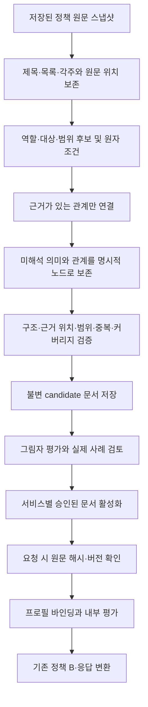

# 복합 복지 자격조건 표현 및 안전한 추천 구조

작성일·최종 갱신일: 2026-10-30 (Asia/Seoul)

구현 기준: `6b982a6e97cab0f9867289e86d7dd319d1adf4fc` — `feat: add semantic welfare eligibility analysis`

상태: **3차-B 구현 기록 + 향후 복합 조건·역설계 설계안.**

> **읽는 순서:** §1–2는 현재 코드와 해당 개발 시점의 검증 결과다. §3–15는 기존 설계 의도를 보존한 **향후 검토 사항**이며, 그 안의 DB 테이블·조건 그래프·일반 논리 평가·활성화 절차는 구현되지 않았다. §3–15의 JSON·DSL은 현재 API 응답이나 운영 DB 구조가 아니다.

## 1. 목적과 범위

교수님 피드백에 따라, **사용자가 실제 입력한 정보와 비교 가능한 필수 조건을 근거로 복지서비스를 예비 추천**한다. 신청 검토 후보는 모든 자격조건 충족, 공식 자격 증명 또는 선정 보장을 뜻하지 않는다. 세부 요건과 실제 선정 여부는 담당 기관의 공식 안내·심사에서 확인한다.

- 입력 정보와 인증된 필수 조건의 일치가 있으면 후보 근거로 사용할 수 있다.
- 일반적인 미입력 세부 요건만으로 후보를 일률 차단하지 않는다.
- 검증된 전체 서비스 필수 조건의 명확한 불일치는 추천 제외 근거로 사용할 수 있다.
- 관련 OR·예외·적용 대상·범위·시간 기준이 불명확하면 추측으로 확정하지 않는다. 단순 입력 부족과 조건 해석·충돌의 불확실성을 구분한다.
- 배점·우대·자녀 조건·세부 지원·다른 상품을 신청자 본인의 전체 서비스 필수 자격으로 승격하지 않는다.
- 개인 월소득, 가구 월소득, 가구 소득인정액, 정책별 소득평가액을 혼용하지 않는다.
- 사용자 자기신고를 공식 자격 증명으로 간주하지 않는다.

3차-B는 기존 평면 파서·매처를 교체하지 않고 **별도 의미 조건 경로를 병행**한다. 운영 DB의 조건 1,749건을 재작성하거나 새 의미 조건 테이블을 만들지 않았다. 이번 문서 갱신도 코드·테스트·설정·운영 DB를 변경하지 않는다.

## 2. 현재 구현과 검증 결과

### 2.1 실제 코드와 실행 경로

| 위치·함수 | 현재 동작 |
|---|---|
| [welfare_api_client.py](../../../backend/app/clients/welfare_api_client.py) · `parse_welfare_service_detail()` | `tgtrDtlCn` → `target_details`, `slctCritCn` → `selection_criteria`, `alwServCn` → `support_content`. 자격 파싱은 앞의 두 필드를 사용한다. |
| [welfare_sync_service.py](../../../backend/app/services/welfare_sync_service.py) · `_persist_received()` | 기존 서비스·평면 조건을 서비스별 트랜잭션으로 저장한다. 의미 조건의 별도 영구 저장은 추가하지 않았다. |
| [welfare_eligibility_condition.py](../../../backend/app/models/welfare_eligibility_condition.py) | 기존 평면 조건 모델 유지. 일반 AND/OR 그래프·의미 문서·활성화 포인터가 저장된다는 뜻이 아니다. |
| [eligibility_condition_service.py](../../../backend/app/services/eligibility_condition_service.py) · `structure_service()`, `parse_text()`, `_unrecognized_residual()`, `clause_role()` | 기존 정규식 파싱, 제한적 역할 구분, 미인식 잔여 보존. 원문이 있으면 런타임에 재해석한다. |
| [eligibility_matching_service.py](../../../backend/app/services/eligibility_matching_service.py) · `analyze_user()`, `analyze_service()` | 기존 Policy B·배열·점수를 먼저 계산하고, 조건과 관측 결과를 의미 경로에 전달한다. |
| [semantic_condition_service.py](../../../backend/app/services/semantic_condition_service.py) · `decompose()`, `evaluate()`, `augment()` | 제한된 의미 분해 → 조건별 문맥 인증 → 기존 비교 재사용 또는 신규 비교 → 별도 추천 근거 결합. |
| [recommendation_decision_service.py](../../../backend/app/services/recommendation_decision_service.py) · `classify()` | 기존 근거 기반 `candidate / excluded / unverified`를 계산하며, 의미 경로가 인증된 근거를 추가로 반영한다. |
| [welfare.py 스키마](../../../backend/app/schemas/welfare.py) · `EligibilityAnalysis` | 기존 필드 유지. `semantic_analysis: list[dict]`는 기본값 `[]`인 추가 필드다. |
| [welfare.py 라우트](../../../backend/app/api/routes/welfare.py) · `get_matched_welfare()`, `diagnose()` | 저장 프로필 GET 진단과 계정 POST 진단이 같은 매칭 서비스로 연결된다. 입력값 숨김·접근 검사를 유지한다. |

현재 경로는 다음과 같다.

```text
저장된 target_details / selection_criteria + 사용자 프로필·추가 JSON
  → 기존 파서·비교기
  → 기존 Policy B status / gap_conditions / review_conditions / match_score
  → 기존 추천 4종 메타데이터
  → SemanticConditionService.decompose / evaluate
       ├─ 기존 비교 관측 재사용
       ├─ 인증된 새 원자만 기존 비교 함수로 비교
       └─ 불확실한 조건·관계·원문 보존
  → RecommendationDecisionService.classify로 기존 추천 결정·decision_evidence 계산
  → augment로 recommendation_decision의 인증 근거 보완
  → analysis_results에 decision_evidence + semantic_analysis 제공
```

이는 실행 흐름의 요약이다. 코드에서는 `analyze_service()`가 의미 평가 결과와 `classify()` 결과를 `augment()`에 전달한다. 새 의미 원자를 기존 gap/review 배열이나 점수에 끼워 넣지 않는다.

### 2.2 SemanticClause / SemanticAtom — 구현 완료

두 모델은 `semantic_condition_service.py`의 **불변 dataclass**이며 SQLAlchemy 테이블이나 영구 조건 그래프가 아니다.

| 구조·필드 | 실제 의미 |
|---|---|
| `SemanticClause` | `clause_ref`, `source_text`, `source_field`, `source_span`, `relation`, `atoms`, `reason_codes` |
| `SemanticAtom`의 비교 표현 | `condition_type`, `operator`, `value_number`, `upper_value_number`, `value_text`, `unit` |
| 원문·관계 연결 | `clause_ref`, `condition_ref`, `source_field`, `source_text`, `source_span` |
| 의미·검증 표현 | `role`, `subject`, `scope`, `time_basis`, `validation`, `reason_codes` |
| `comparison_source` | 인증된 의미를 기존 비교기에 전달하기 위한 표현. 실제 정책 인용문이나 사용자 값으로 가장하지 않는다. |

원문 위치는 Python Unicode code point 기준 `[start, end)`다. `original[start:end] == source_text`로 검증한다. 일반 fallback 원자의 span은 세부 술어 대신 절 전체를 가리킬 수 있다. 별도의 `SourceSpan` 클래스, 필드 스냅샷 테이블, 일반 그래프는 아직 없다.

참조 ID는 파서 버전·원문 필드·위치·원문으로 생성한다. `condition-1` 같은 legacy 참조는 해당 분석 내 위치 참조이며 영구 DB 기본키가 아니다.

### 2.3 분해·문맥 인증·비교 — 제한 구현

- `decompose()`는 기본적으로 줄별 절을 만들고, 완결된 `REGISTERED`·`COMPOUND` 문법을 적용한다.
- `REGISTERED`는 연령 하한 + 본인 등록장애 + 선택적 미취업 또는 특정 장애 유형을 가진 대상 선언을 AND로 분리한다.
- `COMPOUND`는 제한된 연령·미취업 청년·소득 문장 형식을 지원한다. 임의의 자연어 AND 전체를 해석하지 않는다.
- 미지원 절은 기존 파서 결과를 `extracted_not_certified`로 보존한다. OR 표현은 표시할 수 있지만 분기 범위·중첩 관계를 일반적으로 평가하지 않는다.
- `_context_reasons()`는 조건별로 대상·선정 기준·주석을 확인한다. 순수 참조, 검증된 절차·지원 내용 안내, 제한된 훈련·수당 범위 등 **독립성이 확인된 형식만** 허용한다. 문장이 무관하다고 입증할 수 없으면 보류한다.
- 신청자 연령은 `_compare_age()`, 고용·등록장애는 `_compare_profile_condition()`을 재사용한다. 등록장애 YES만으로 지적·자폐성 등 장애 유형을 충족시키지 않는다.
- 기존 `_compare_income_ratio()`를 호출할 수 있는 제한된 소득인정액 경로는 존재한다. 지표·가구원·기준 연도 등 기존 검사를 충족해야 한다. 이 사실은 실제 복합 가구 소득·범위·시점 해석이 완료됐다는 뜻이 아니다.

평가된 dict에는 `role_subject_scope_verified`, `semantics_verified`, `comparison_result`, `comparison_origin`, `comparison_attempted`, `decision_usable`, `reason_codes`, `parser_version` 및 가능한 원문·legacy 연결이 포함된다. 항목 종류에 따라 일부 키가 없을 수 있다.

- `comparison_result`: `passed / failed / unknown`; 일부 미평가·legacy 안내는 `not_evaluated`. `unknown`은 검토가 남는다는 뜻이며 자동 실패가 아니다.
- `comparison_origin`: `legacy_reuse / semantic_new / not_attempted / legacy_unlinked`.
- 역할·대상·범위가 인증되어도 입력이나 비교 규칙이 없으면 `decision_usable=False`일 수 있다.
- `COMPARISON_NOT_ATTEMPTED`와 `NO_VALID_INPUT_COMPARISON`을 구분한다. 둘을 모두 사용자 입력 부족으로 해석하지 않는다.
- `_reuse_comparison()`은 원문 위치와 재검증된 술어를 확인한다. 연령 범위의 두 기존 경계 결과를 함께 재사용할 수 있다.
- 교차 필드의 등록장애 재사용은 정확한 독립 등록장애 술어에 한정한다. **비교 결과만 재사용하며 기존 항목의 역할·범위 인증을 상속하지 않는다.**
- `_attach_legacy_anchors()`는 자동 비교 관측을 원문과 연결한다. 위치·술어를 확인하지 못하면 `source_span=None`과 보류 사유를 남긴다.
- `legacy_condition_ref(s)`, `legacy_comparison_sources`, `clause_text/span`, `affected_condition_refs`로 가능한 근거를 연결한다. 재사용 비교는 `decision_evidence`에 중복 추가하지 않는다.

### 2.4 교수님 피드백에 따른 추천 분류

| recommendation_decision | 사용자 의미 | 현재 판정 원칙 |
|---|---|---|
| `candidate` | 신청 검토 후보 | 입력 정보와 인증된 필수 조건의 일치 근거가 있고 확정 불일치가 없으며, 관련 미해결 충돌이 후보 확정을 막지 않는 경우 |
| `excluded` | 현재 정보상 추천 제외 | 전체 서비스에 적용되는 검증된 필수·제외 조건과의 명확한 불일치. 관련 대안·예외·대상·범위가 미해결이면 그 조건을 제외 근거로 사용하지 않음 |
| `unverified` | 판단 보류·추가 확인 | 비교 근거 부족, 역할·대상·범위·시간 또는 실패 조건의 대안·예외 관계를 인증할 수 없는 경우 |

인증된 불일치는 무관한 검토 항목만으로 무효화하지 않는다. 반대로 기존 gap이 있다는 이유만으로 excluded, 기존 통과가 있다는 이유만으로 candidate를 만들지 않는다. 의미 경로는 인증된 AND 내 명확한 실패를 일치보다 우선하며, 미해결 실패 충돌이 있으면 일치만으로 후보로 승격하지 않는다.

candidate에 일반 미입력 세부 요건이 남을 수 있다. **일부 검증된 일치 근거가 있다는 예비 추천이며 전체 자격 충족이 아니다.** `decision_reason`과 `decision_warnings`로 신청 전 확인 및 공식 심사 필요성을 안내한다. `match_score`를 선정 확률로 표시하지 않는다.

### 2.5 Policy B·기존 API와 별도 유지

| 기존 gaps | 기존 reviews | 기존 자동 비교 | status |
|---|---|---:|---|
| 있음 | 있음 | 무관 | `needs_review` |
| 있음 | 없음 | 1개 이상 | `ineligible` |
| 없음 | 있음 | 무관 | `needs_review` |
| 없음 | 없음 | 0개 | `needs_review` |
| 없음 | 없음 | 1개 이상 모두 통과 | `eligible` |

- 기존 `match_score = round(passed_count / evaluated_count * 100, 1)`; 기존 평가가 없으면 0.0이다. 의미 경로의 신규 비교·보류 원자를 기존 점수에 추가하지 않는다.
- 기존 `status`, `gap_conditions`, `review_conditions`, `confirmed_conditions`, `notes`와 추천 4종 `priority_recommendation / priority_consideration / condition_mismatch / additional_review`를 유지한다.
- 위 항목은 새로운 3종 `recommendation_decision`과 별개다. 같은 서비스가 `status=needs_review`이면서 `candidate` 또는 `excluded`일 수 있다.
- `policies`는 여전히 기존 `status=eligible` 서비스만 포함한다. 후보를 조회할 때 이 목록만 사용하지 않고 전체 `analysis_results`의 `recommendation_decision`을 확인해야 한다.
- `semantic_analysis`는 `EligibilityAnalysis`의 기본값이 있는 추가 필드다. 과거 응답·저장 스냅샷을 읽는 호환성을 테스트한다. 기존 `decision_evidence`를 제거하거나 구조화 결과로 덮어쓰지 않는다.
- `POST /api/v1/welfare/diagnose`와 `GET /api/v1/welfare/matched`의 동일 프로필 결과 및 계정 저장 결과의 일관성을 테스트한다. 새 프런트 표시 기능을 이번 3차-B에서 구현했다는 의미는 아니다.

### 2.6 실제 정책 검증 스냅샷

**2026-10-30, 위 구현 커밋과 당시 저장된 152개 서비스·1,749개 조건 및 계정 연결 프로필을 기준으로 한 개발 검증 결과**다. 일반적인 추천 성능, 정책 전체의 의미 정확도, 향후 사용자 결과를 나타내는 수치가 아니다. 사용자 프로필의 실제 값과 식별자는 기록하지 않는다.

| 항목 | 결과 |
|---|---:|
| 실제 등록장애 복합 문장 분해 성공 | 3개 서비스·3개 절 |
| 추출 원자 | 8개 |
| 역할·대상·범위 인증 원자 | 6개 |
| 추천 근거로 사용 가능한 원자 | 5개 |
| 위 8개 중 기존 비교 재사용 | 6개 |
| 위 8개 중 신규 자동 비교 | 1개 |
| 위 8개 중 장애 유형 비교 보류 | 1개 |
| 기존 자동 비교의 의미 근거 연결 | 66/66개 |
| 기존 Policy B 비교 / 충족 / 미충족 | 66 / 50 / 16개 |
| 기존 review_conditions 합계 | 1,481개 |
| 기존 비교와 신규 비교를 합친 중복 없는 비교 | 67개 |
| 추천 분류 | candidate 3 / excluded 3 / unverified 146 |
| 전체 백엔드 테스트 | 547 passed, 491 warnings |

역할 인증, 비교 여부, 추천 사용 여부는 서로 다른 단계이므로 위 건수를 합산하지 않는다. 3차-B 보완 전 분류는 candidate 3 / excluded 1 / unverified 148이었으며, 새 문맥 인증 후 두 서비스가 excluded로 전환됐다. 기존 candidate 3개와 장애인일자리 excluded는 유지됐다. 152개 서비스의 기존 Policy B 상태·점수·배열·기존 추천 메타데이터 차이는 0건이었다.

| 검증 서비스 | 실제 원문 발췌 | 분해·안전성 |
|---|---|---|
| WLF00003189 중증장애인직업재활지원 | “15세 이상 등록장애인을 대상으로 합니다.” | 연령 AND 등록장애. 세부 훈련·수당 범위를 별도 확인하며, 기존 등록장애 비교 결과를 재사용해 전체 서비스 필수 근거를 인증 |
| WLF00001165 발달장애인 주간활동서비스 | “만 18세이상 「장애인복지법」상 등록된 지적 및 자폐성 장애인을 지원합니다.” | 연령 AND 등록장애 AND 장애 유형. 신규 비교는 등록장애 1개이며 장애 유형은 unknown으로 보존 |
| WLF00000025 장애인일자리지원 | “18세 이상 「장애인복지법」상 등록된 미취업 장애인을 대상으로 합니다.” | 세 원자 추출·기존 비교 재사용. 등록장애 근거 인증, 관련 선정 기준이 남는 연령·고용의 새 추천 인증은 보류 |

이 수치는 직전 구현 검증 기록이다. 이번 문서 갱신에서 운영 DB 재진단·외부 API 조회·전체 테스트를 다시 실행했다는 뜻은 아니다.

### 2.7 테스트 근거와 재현 명령

- [test_semantic_conditions.py](../../../backend/tests/test_semantic_conditions.py): 합성 AND 분해·경계값·소득 지표 미확정·OR·여러 대상 집단·기존 필드 보존.
- [test_semantic_registered.py](../../../backend/tests/test_semantic_registered.py): 실제 등록장애 세 문장, 장애 유형 별도 검토, 역할·대상·범위 반례, 독립 안내/관련 예외, 주석의 다른 연령 조건, 비교 재사용·중복 방지·근거 연결 누락 4건.
- [test_recommendation_decision.py](../../../backend/tests/test_recommendation_decision.py): 기존 후보 3개·등록장애 제외·Policy B·개인정보 보호 및 두 진단 API 일관성.
- [registered_semantic_excerpts.json](../../../backend/tests/fixtures/registered_semantic_excerpts.json): 기존 운영 DB에서 읽은 공개 정책 원문과 출처 설명. 사용자 데이터·인증정보는 포함하지 않는다.
- 기존 프로필·매칭·계정·동기화 테스트도 전체 실행에 포함됐다. 경고는 AnyIO 별칭, `datetime.utcnow()`, SQLite 날짜 변환의 폐기 예정 경고였다.

다음 명령은 저장소 루트에서 backend로 이동한 뒤 실행하는 **재현용 안내**다. 이번 문서 작업의 실행 결과로 기재하지 않는다.

```powershell
cd backend
.\.venv\Scripts\python.exe -B -m pytest -q -p no:cacheprovider
```

### 2.8 부분 구현과 미구현 범위

| 구분 | 현재 범위 / 보류한 범위 |
|---|---|
| 부분 구현 | 제한된 AND·OR 표시, 역할·대상·범위 메타데이터와 인증. 모든 문장의 관계·대상·역할을 알아내는 일반 해석기는 아님 |
| 부분 구현 | `time_basis`와 시간 관련 보류 사유. 신청일·보호종료일·법 시행일 기준의 일반 계산기는 없음 |
| 부분 구현 | 기존 소득 비교 재사용과 지표 미확정 보류. 복잡한 가구 소득인정액·중위소득 범위·적용 연도·시점 해석은 미구현 |
| 미구현 | 일반적인 중첩 AND/OR·최소 N개·예외/면제의 완전한 평가 |
| 미구현 | 장애 등록 외 의사 소견 등 별도 인정 경로의 완전한 처리 |
| 미구현 | 여러 대상 집단·세부 지원 범위·예외 관계의 일반화 및 전체 정책의 자동 자격 판정 |
| 미구현 | 사용자 선택 복지서비스 기반 역설계, 조건 변경 시뮬레이션 |
| 미구현 | 영구 조건 그래프, `PolicyConditionDocument`, `PolicyConditionActivation`, schema_version 기반 활성화·rollback |

런타임은 기존 파서의 `PARSER_RULESET_VERSION=2026-10-30-age-role-safety-1`, 의미 파서의 `VERSION=2026-10-30-semantic-registered-2` 및 추천 분류기 규칙 버전을 근거로 기록한다. 기존 평면 파서 LRU는 최대 256개, 의미 절 분해 LRU는 최대 512개 입력을 보존한다. 프로필별 결과를 이 공용 분해 캐시에 넣지 않는다. 프로세스별 캐시이며 영구 버전 문서 저장소가 아니다.

평면 캐시는 클래스·규칙 버전·두 원문 필드를 키로 사용한다. 의미 분해 캐시는 클래스·원문·출처 필드를 키로 사용하며 `VERSION`은 별도 키 인자가 아니라 참조 ID와 근거에 기록된다. 의미 규칙을 변경할 때는 버전을 갱신하고 기존 프로세스의 캐시 무효화 또는 재시작도 고려해야 한다.

### 2.9 향후 역설계 재사용 계획 — 미구현

향후 사용자가 원하는 서비스를 선택했을 때, 현재 `semantic_analysis`의 원자·비교 결과·보류 사유와 `decision_evidence` 연결을 재사용하여 다음을 보여주는 방향이다.

| 향후 안내 | 재사용 가능한 현재 근거 | 추가 설계 필요 |
|---|---|---|
| 이미 충족 / 명확히 불일치한 조건 | `comparison_result`, 원문·숫자·연산자, `decision_usable` | 역할·범위가 인증된 사실과 legacy 관측을 구분 |
| 사용자 입력 부족 | 비교 시도 여부·입력 필드 참조·보류 사유 | 모든 unknown을 미입력으로 단정하지 않는 상세 분류 |
| 원문 해석 미확정 | `validation`, 문맥 인증 결과, `reason_codes` | 일반 관계·시점·대상 해석 |
| AND/OR 및 예외 관계 | `relation`, `affected_condition_refs`, 절 원문 | OR 분기·예외의 영향 범위를 갖는 구조와 검증 |
| 조건별 판단 근거 | `source_field/text/span`, 절 위치, legacy 원문·참조·버전 | 원문 변경 후 과거 근거 재현을 위한 스냅샷·영구 ID |

역설계 화면·선택 서비스 분석 알고리즘·조건 변경 시뮬레이션은 아직 구현하지 않았다. legacy 연결만으로 필수 역할이 인증되는 것도 아니다. 사용자 입력값을 로그나 공개 정책 문서에 복제하지 않으며, 현재 존재하는 계정 분석 스냅샷을 완전한 정책 버전·역설계 trace 저장소로 간주하지 않는다.

---

**이하 §3–15: 향후 검토할 설계 대안.** 기존 문서의 의미 관계·안전성·마이그레이션 제안을 보존한 것이며 현재 3차-B의 필수 구조가 아니다. 도입 여부·점수 단위·DB 변경은 별도 결정이 필요하다.

## 3. 대안 비교와 권장안 — 향후 검토

| 대안 | 장점 | 단점 |
|---|---|---|
| A. 기존 조건 테이블에 역할·그룹 컬럼 추가 | 기존 조회·행 단위 검색 활용 | 기존 SQLite 테이블 마이그레이션 필요, 버전 간 그룹 연결과 복잡한 예외 표현이 어려움 |
| B. 별도 문서 헤더 + 버전별 JSON 조건 그래프 | 기존 테이블 보존, 서비스별 원문·버전 스냅샷과 원자적 교체, 중첩 논리 표현, SQLite 호환 | JSON 내부 FK는 애플리케이션 검증 필요, 노드별 SQL 집계가 번거로움 |
| C. 별도 문서·노드·관계·근거 테이블 | 노드 검색과 SQL 집계에 유리, 일부 관계를 DB 제약으로 보장 | 테이블·조인·버전 정합성 관리 비용이 크고 초기 구조 변경이 잦을 수 있음 |

**장기 저장 대안으로 B를 우선 검토한다.** 현재 3차-B는 메모리 구조와 LRU로 동작하므로 이 저장 모델은 필수 선행조건이 아니다. 별도 영구 버전·감사 요구가 확인될 때 기존 데이터 보존 비용과 함께 판단한다. 이는 사용자에게 최종 승인받은 선택이 아니라 검토용 제안이다. 노드 검색 요구가 커지면 B의 안정된 문서를 기준으로 C 형태의 파생 검색 인덱스를 만들 수 있다. C로 옮기더라도 판정의 기준 문서와 버전 의미는 유지한다.

## 4. 권장 저장 모델 — 기존 테이블과 병행 — 향후 검토

### 4.1 `PolicyConditionDocument` (신규 제안)

| 필드 | 의미·제약 |
|---|---|
| `document_id` | 불변 UUID PK |
| `serv_id` | 기존 `welfare_services.serv_id` FK. 서비스 삭제 정책은 보존 우선 RESTRICT 제안 |
| `source_hash` | 아래 원문 스냅샷을 정규 JSON 직렬화한 SHA-256 |
| `schema_version` | 문서 구조 버전. 미지원 버전은 평가 금지 |
| `parser_version`, `ruleset_version` | 생성 코드·의미 규칙 버전. confidence와 별개 |
| `build_identity` | 빌드/커밋 식별자. 로컬 수정이 있으면 규칙 해시 포함 |
| `validation_status` | `candidate`, `validated`, `rejected` |
| `coverage_status` | `complete`, `partial`, `unknown` — 자동 비교 가능한 양이 아니라 원문의 의미 단위 보존 상태 |
| `payload` | 원문 스냅샷, 주체·범위·노드·근거·진단 JSON |
| `generated_at` | UTC 생성 시각 |
| `validated_at`, `validation_method` | 구조 검증 시각·검증기 버전. 법적 정확성 승인과 혼동 금지 |
| `supersedes_document_id` | 같은 서비스의 이전 문서, 선택 사항 |

동일 서비스의 같은 입력·버전 중복 생성을 막는 UNIQUE 키는 `(serv_id, source_hash, schema_version, parser_version, ruleset_version, build_identity)`로 제안한다. 서로 다른 문서를 한 행에서 덮어쓰지 않는다.

### 4.2 `PolicyConditionActivation` (선택 포인터)

- `serv_id`: PK/FK — 서비스당 활성 문서 하나.
- `document_id`: 새 문서 FK.
- `activated_at`, `activation_reason`, `previous_document_id`: 활성화 근거 및 회수 기록.
- 복합 참조/검증으로 **문서의 serv_id와 포인터의 serv_id 일치**를 보장한다.
- 구체적으로 문서의 `(serv_id, document_id)` UNIQUE와 포인터의 같은 두 컬럼 복합 FK를 제안한다. 활성화 교체는 이전 document_id를 조건으로 한 compare-and-swap으로 충돌을 검출하며, 충돌 시 재검토 없이 덮어쓰지 않는다.
- validated 문서만 활성화한다. 포인터 변경은 트랜잭션 하나로 처리한다.
- 검증 중 문서, 오래된 원문의 문서, 미지원 버전은 포인터가 있어도 실행에 사용하지 않는다.

기존 `WelfareEligibilityCondition`은 유지한다. 새 문서와 1:1 행 대응은 전제하지 않는다. 추적이 필요하면 legacy 행 ID를 보조 근거로 참조하되 신규 노드의 정체성을 그 ID에 의존시키지 않는다. 저장된 legacy 행이 재생성되어도 새 문서가 손상되면 안 된다.

### 4.3 원문 스냅샷과 변경 감지

`sources`는 정확히 저장된 `target_details`, `selection_criteria`와 각각의 SHA-256을 포함한다. `reference_year`도 입력 스냅샷에 포함한다. `support_content`는 현재 비교 입력이 아니며, 나중에 입력으로 승인할 경우에만 구조 버전·원문 해시에 추가한다.

원문 해시는 공백을 임의 제거한 텍스트가 아닌 **정확한 입력 문자열** 기준이다. null과 빈 문자열의 정규화 규칙은 버전으로 고정한다. 초기 제안은 null을 빈 문자열로 처리한다. 문서에 그 정규화 정책을 기록한다.

현재 원문과 source_hash가 다르면 stale이다. 예전 검증 문서를 현재 원문에 적용하지 않는다. 생성 작업은 원문을 읽은 뒤 검증·활성화 직전에 해시를 다시 비교한다. 그 사이 원문이 변하면 활성화하지 않는다.

## 5. 문서 내부 구조 — 향후 검토

### 5.1 원자 조건

```json
{
  "id": "a-age",
  "kind": "atom",
  "role": "requirement",
  "subject_ref": "applicant",
  "scope_ref": "program",
  "predicate": {
    "type": "age",
    "metric": "age_in_completed_years",
    "operator": "gte",
    "value": {"kind": "integer", "value": 18},
    "unit": "year",
    "user_binding": "user.age"
  },
  "time": {"anchor": "current", "precision": "day", "resolution": "unresolved"},
  "source_refs": ["s-age"],
  "interpretation": {"state": "confirmed", "reason_codes": []},
  "comparison": {"supported": true, "requirements": ["exact_time_basis"]}
}
```

위 JSON은 형식 예시이며 실제 원문 위치를 계산한 결과가 아니다. `current`와 실제 정책의 신청일 기준이 다르면 time resolution을 충족하지 못해 검토한다. 기존 current age 비교와의 전환은 호환성 테스트로 명시한다. 날짜로 정확한 만 나이를 계산할 정보가 없으면 현재 나이를 과거 시점에 대입하지 않는다.

| 구성 | 내용 |
|---|---|
| `type` | 기존 age/employment/region/income_ratio/income_amount/target_group 등을 재사용. 내부 세부 metric은 별도 |
| `metric` | 예: 현재 나이, 보호종료 당시 나이, 등록장애, 본인 월 소득, 가구 소득인정액, 사업장 소재지 |
| `operator` | equals, not_equals, in, not_in, gt/gte/lt/lte, between, exists. 지원되지 않는 연산자는 review |
| `value` | 정수·Boolean·enum·집합·날짜·기간·범위. 금액은 원 정수, 비율은 Decimal로 복원 가능한 문자열 |
| `between` | 하한·상한 및 각 포함 여부를 명시. 예: `(50, 100]`. 한 원자 조건으로 표현해 이중 점수화하지 않음 |
| `unit` | 원/月, %, 년, 일 등. 법적 산정 단위와 비교 대상에 맞아야 함 |
| `user_binding` | 제한된 서버측 바인딩 레지스트리 키. JSON 경로를 임의 코드로 실행하지 않음 |
| `comparison` | 비교기 지원 및 증거 요건. 사용자 값 존재는 별도 실행 시 판단 |

`comparison.supported=true`만으로 자동 평가하지 않는다. 역할·대상·범위·시간·원문·관계가 확인되고 입력이 유효해야 한다. 기존 `comparison_ready`는 이 중 일부를 나타내는 legacy 값일 뿐 새 구조의 완전성 증명이 아니다.

### 5.2 역할

| role | 처리 |
|---|---|
| `requirement` | 범위가 확인된 필수 충족 조건 |
| `exclusion` | 해당하면 제외되는 **원래 사실**을 저장. 비교 결과를 통과 gate로 변환할 때만 반전 |
| `preference` | 우대·배점. `mode=priority/score`, 점수표 원문·구간 별도 보존. 필수 gate에 포함하지 않음 |
| `information` | 절차·신청 안내. notes로 전달 |
| `definition` | 대상·가구·산정 용어 정의. 독립 자격이나 사용자 값으로 비교하지 않음 |
| `external_review` | 기관 재량·의학·금융 등 별도 심사. 현재 프로필만으로 판정하지 않음 |
| `unresolved` | 역할 자체를 확인하지 못함. 임의로 안내나 우대로 낮추지 않고 review |

필수/제외/우대는 enum의 이름이 아니라 원문의 증거와 검증 규칙으로 결정한다. 하나의 문장에 여러 역할이 있으면 별도 노드로 분리하고 각각의 근거 구간을 연결한다. 분리가 불확실하면 unresolved 노드와 원문 전체를 보존한다.

### 5.3 적용 대상 (subject)

후속 그래프 모델은 `applicant`, `spouse`, `child`, `guardian`, `household`, `origin_household`, `employer`, `guarantor`, `unresolved`를 구분하는 방향을 제안한다. 현재 문자열 메타데이터에 값이 기록될 수 있다는 사실과 해당 주체의 자동 비교 지원은 별개다. 각 subject는 문서 내 ID, 종류, 신청자와의 관계 및 선택 제약을 갖는다.

- 자녀·보호자처럼 여러 명이 있을 수 있으면 `quantifier=any/all/exactly_one/unresolved`를 별도로 표현한다. 어느 자녀인지 모르면 신청자의 값을 사용하지 않는다.
- household는 정책별 정의 노드와 연결한다. 청년가구·원가구·건강보험 가구를 같은 household로 합치지 않는다.
- 사업장 인원은 applicant의 고용 상태가 아니다. 보증인의 신용 상태는 신청자 신용 상태가 아니다.
- 정의가 실행 가능한 범위까지 해석되지 않으면 해당 바인딩은 unsupported로 남긴다.

### 5.4 적용 범위 (scope)

| kind | 예시 | 기본 동작 |
|---|---|---|
| `program` | 전체 사업 | 명시된 필수 gate를 전체 상태에 사용 |
| `benefit_component` | 등록관리사업의 의료비 지원 | 독립 root를 가지며 기본 전체 상태에는 섞지 않음 |
| `target_population` | 출소예정자/위기청소년, 사업 단계 | 해당 집단의 분기 안에서만 평가 |
| `other_product` | 미소금융재단의 다른 대출 | 현재 서비스의 gap/score에서 제외, 다른 상품 안내 notes |
| `unresolved` | 어떤 항목·집단인지 모름 | 범위 검토 노드 생성 |

scope는 `parent_scope_ref`, label, source_refs, 선택 조건과 **명시적 상속 관계**를 갖는다. 단순히 본문에 앞서 나왔다는 이유로 조건을 모든 하위 scope에 상속하지 않는다.

세부 지원의 결과는 내부 trace에 보관한다. 현재 API가 서비스 단위이므로 초기 외부 응답은 **program root**만 집계하고 notes에 “세부 지원은 별도 기준 적용”을 명시한다. 요청에서 사용자가 세부 지원을 선택하는 기능은 이번 최소 설계에 포함하지 않는다. 상세 선택 API는 별도 승인 대상이다.

### 5.5 원문 위치

제안 구조 `SourceSpan`은 `source_field`, `start`, `end`(반개구간), `exact_quote`, `field_hash`, `source_snapshot_ref`를 갖도록 한다. 현재는 §2.2의 tuple/list 위치를 사용하며 이 별도 클래스는 없다. 인덱스는 원문 스냅샷의 **Python Unicode code point** 기준으로 고정한다. JS UTF-16 인덱스로 직접 사용할 수 없다.

- 원문의 목록번호·줄바꿈·문장부호를 보존한다.
- 전처리 문자열로 추출했다면 원문 offset 매핑이 반드시 있어야 한다.
- `snapshot[start:end] == exact_quote`를 검증한다. 임의로 계산한 위치를 기록하지 않는다.
- 중첩 근거는 허용하되 동일 근거·동일 의미 조건의 중복 점수화를 금지한다.
- source_text 하나가 여러 역할을 담으면 다중 source_refs와 정확한 하위 구간으로 연결한다.

### 5.6 논리 노드와 관계

노드는 불변 문서 내 고유 ID로 연결한다. **소유 트리**를 기본으로 하되 정의·예외 대상은 타입이 있는 참조로 연결하는 비순환 그래프다. 한 평가 gate는 하나의 점수 소유 경로만 가진다.

| kind | 필수 구성 | 의미 |
|---|---|---|
| `all` | children | AND. 빈 all은 true로 자동 충족시키지 않고 구조 오류 |
| `any` | children | OR. 하나의 명확한 통과 대안이 있으면 충족 가능 |
| `at_least` | children, n | 서로 구분되는 대안 N개 이상. `1 <= n <= len(children)` |
| `exclude` | predicate_ref | 제외 사실이 true이면 자격 gate false, false이면 gate true |
| `exception` | target_ref, trigger_ref, effect | 특정 대상 gate만 waive/replace. 대상·효과 불명이면 평가 금지 |
| `unresolved_relation` | children, raw_relation_refs, reason | AND/OR로 치환하지 않고 review |
| `atom` | predicate | 원자 비교 |

`exception.effect`는 초기에는 `waive`만 평가 지원을 제안한다. `replace`는 교체 subtree와 적용 범위가 명시돼야 하며, 최초 구현에서는 표현만 하고 review로 유지해도 된다. 임의의 NOT 그룹을 허용하기보다 `exclude`를 명시적으로 사용해 이중 반전 오류를 막는다.

연결 누락, 순환, dangling ref, 다른 scope 노드의 무단 유입, 모순된 주체, 모호한 예외 대상을 구조 검증에서 거부한다.

### 5.7 시간 기준

`current`, `application_date`, `protection_end_date`, `protection_start_date`, `employment_end_date`, `program_start_date`, `law_effective_date`, `source_reference_year`, `unresolved`를 구분한다. anchor ID, 정밀도(day/month/year), 적용 기간의 포함/미포함 경계와 달력 산정 규칙을 기록한다.

- “보호 종료일 기준 과거 2년”은 현재 나이·개월 수로 대체하지 않는다.
- “6개월(180일)”을 일반적으로 같은 기간으로 단정하지 않는다. 해당 정책의 명시적 표현과 산정 규칙을 보존한다.
- 기준 중위소득의 금액 연도와 사용자 소득 측정 기간을 별도로 기록한다.
- “2025년 4인 가구 예시”는 신청자 가구 기준·적용 연도를 결정하지 않는다.
- 날짜·시행시점·나이 산정 정보가 없거나 충돌하면 review.

## 6. 파싱·검증·생성 흐름 — 향후 검토



아래는 영구 문서 방식을 채택할 때의 생성 절차다. `validation_status=candidate`는 제안 문서의 생성 상태이며 추천 분류 `recommendation_decision=candidate`와 무관하다.

1. 원문·reference_year를 일관된 스냅샷으로 읽는다.
2. 기존 정규식 수치 추출기를 재사용할 수 있지만 의미·범위 결정과 분리한다.
3. 절 제목·목록·각주의 스팬을 유지한다. 구두점만으로 예외 범위를 확정하지 않는다.
4. 필수·우대·정의·다른 상품 등 역할과 범위의 증거를 연결한다.
5. 논리 관계를 판별할 수 없으면 원자 조건을 독립 필수 조건으로 펼치지 않는다.
6. 모든 **자격에 영향을 줄 수 있는 미해석 부분**을 unresolved 노드 또는 root blocker로 보존한다. 구두점·단순 수사 제거는 명시된 규칙만 허용한다.
7. coverage=complete는 “다 해석했다”가 아니라 “의미 있는 원문이 조건/정의/안내/미해석 중 하나에 보존됐다”는 뜻이다. unresolved가 있으면 complete여도 eligible을 막을 수 있다.
8. 외부문서·법률 참조는 인용 자체와 실제 별도 판단을 구분한다. 필요한 본문이 없으면 외부 판단 review로 남긴다.
9. 생성 실패 시 기존 원문·legacy 조건·검증 문서를 훼손하지 않는다. 실패 이유만 별도 생성 작업 결과로 남기는 구조를 후속 구현에서 정한다.

## 7. 내부 평가 규칙 — 향후 검토

### 7.1 세 값 논리와 실행 상태

논리 값은 `T`, `F`, `U`(unknown)다. 별도로 applicability=`applicable/not_applicable/unresolved`, execution=`evaluated/unsupported/missing_input/waived/skipped/error`를 기록한다. waived나 not_applicable을 T로 바꾸어 점수에 넣지 않는다.

| 관계 | T | F | U |
|---|---|---|---|
| ALL | 모두 T | 하나라도 F | F가 없고 U 존재 |
| ANY | 하나라도 T | 모두 F | T가 없고 U 존재 |
| AT_LEAST(n) | T 수 >= n | T 수 + U 수 < n | 나머지 |
| EXCLUDE(p) | p=F | p=T | p=U |

표의 논리 값은 내부 계산이다. **ALL이 F여도 별도의 unresolved 필수 요소가 있으면 외부 상태는 정책 B에 따라 needs_review**가 된다. 내부 F를 곧바로 최종 ineligible로 반환하지 않는다.

### 7.2 예외

- **초기 지원 범위 제안:** waive는 명확한 ALL의 직접 자식인 독립 필수 gate에만 자동 적용한다. target 자체는 원자 또는 완결된 그룹일 수 있으나 OR/AT_LEAST 내부의 대안·개수 기준을 바꾸는 면제는 초기 자동 평가 범위 밖이다. 예: 운전교육의 g2 전체 면제는 program ALL의 자식이므로 표현 가능하다.
- E가 명확한 면제 조건이고 T이면 지정된 target만 waived. 면제된 gate는 점수·gap·confirmed에서 제외하고 notes/trace로 설명한다.
- E=F이면 target을 정상 평가한다.
- E=U이고 target=F이면 그 실패는 아직 확정적 gap이 아니다. 예외와 대상 gate를 묶어 review로 전달한다.
- E=U이고 target=T일 때, **예외가 해당 조건을 면제만 한다고 검증된 경우** target의 통과는 유지할 수 있다. 예외가 새 의무를 추가하거나 범위가 불명확하면 전체 exception 관계 U.
- 예외의 효과·대상·다른 필수 조건에 대한 영향이 불명확하면 외부 근거 확인 전 자동 적용하지 않는다.

#### 면제·비적용 상태의 부모 집계

- waived의 내부 truth는 T/F/U가 아닌 `null`이며, 실행 상태와 근거를 별도로 가진다. 지원되는 ALL은 확정 면제된 직접 자식을 제약 집합에서 제거한 뒤 나머지 T/F/U를 계산한다. 면제를 통과 조건으로 세지 않는다.
- 면제 뒤 적용 gate가 하나도 남지 않으면 `U / NO_ACTIVE_EVALUATION`으로 처리한다. 빈 ALL이나 면제 사실만으로 eligible·100점을 만들지 않는다. 다른 평가 단위가 없으면 정책 B의 평가 0건 규칙을 적용한다.
- `ANY(F, waived)` 또는 `AT_LEAST(2,[T, waived, F])`처럼 대안 내부 면제가 발생하면 해당 그룹은 `U / UNSUPPORTED_WAIVER_COMPOSITION`이다. N을 줄이거나 waived를 T로 바꾸거나 대안을 임의 삭제하지 않는다. 그룹 review 1건이며 그룹 점수에는 포함하지 않는다. 같은 그룹의 다른 T가 있더라도 이 미지원 조합은 초기에는 자동 통과시키지 않는다.
- not_applicable은 검증된 요청 scope 밖의 노드에만 사용하고 해당 scope root 자체를 program 집계에서 제외한다. 필수 관계 안의 주체·분기·적용 여부를 확정하지 못한 것은 not_applicable이 아니라 U다.
- ALL/ANY/AT_LEAST 자식에서 명시적으로 처리하지 않은 not_applicable이 발견되면 구조 또는 applicability 검증 실패로 그룹 review를 만든다. 특히 최소 N의 대안 개수를 자동으로 줄이지 않는다.
- 지원 범위를 넓히려면 이 연산들의 합성 의미와 점수 단위를 별도 승인·버전으로 정의해야 한다. 이 제한은 구현자가 임의 결정할 항목이 아니다.

### 7.3 입력·안전성

- None/UNKNOWN/빈 문자열은 미확인. False와 0은 타입·도메인이 맞으면 유효하다.
- 빈 배열은 명시적 ‘해당 없음’인지 미입력인지 필드 계약에 따라 구분한다. 빈 객체만으로 어떤 자격의 부재도 추정하지 않는다.
- 사용자 값 존재만으로 공식 자격 증명을 얻었다고 보지 않는다.
- 등록 주소와 일반 region, 현재 employment enum과 실업급여 자격을 혼동하지 않는다.
- 미지원 metric·주체·연산자·시간·관계는 U. 비교기 예외는 sanitized error + U로 남기며 통과로 처리하지 않는다.
- 향후 엄격한 자격 그래프 평가에서는 root coverage가 partial/unknown이거나 미지정 범위의 자격 관련 잔여가 있으면 root blocker review를 생성하는 안이다. 이를 예비 추천의 일률 차단 규칙으로 사용하지 않는다. 추천 분류는 §2.4처럼 입력 부족과 관련 충돌을 구분해야 한다.
- 주체·역할·시간이 불명확한 자식은 OR의 자동 통과 근거가 될 수 없다. 검증된 OR에서 명확한 T 대안이 있으면 다른 대안의 불필요한 입력 부족은 전체 review로 강제하지 않는다. OR 바깥 공통 의무·미해석 예외는 계속 review다.

## 8. 기존 정책 B·점수·추천·API와의 호환 — 향후 검토

### 8.1 평가 결과를 기존 필드에 투영

향후 일반 그래프 평가기를 도입한다면 내부 결과에 `truth`, `applicability`, `execution`, `reason_codes`, `source_refs`, `children_trace`, `decisive_nodes`, `review_dependencies`를 두고 별도 adapter로 투영하는 안이다. **현재는 이 adapter가 없으며, 기존 배열·점수를 먼저 계산한 뒤 별도 의미 결과로 추천 근거만 보완한다.**

핵심은 **OR의 실패한 한 갈래가 전체 서비스 gap으로 새지 않게 하는 것**이다.

| 내부 형태 | 기존 응답 변환 |
|---|---|
| 명확한 AND의 독립 필수 원자 gate | 적용 가능한 자식 gate별 passed/failed/review. F와 U가 함께면 gap과 review를 각각 유지 |
| OR 또는 AT_LEAST | 그룹당 하나의 평가 단위. T이면 confirmed 1건, F이면 group gap 1건, U이면 group review 1건. 실패한 개별 대안은 gap에 넣지 않음 |
| 숫자 범위 | 포함 경계를 가진 한 원자 gate로 평가·점수화 |
| 제외 | ‘제외 사실’의 결과를 통과 gate로 반전한 뒤 한 평가 단위로 처리 |
| 면제 | waived로 trace/notes, 점수 분모·분자에 넣지 않음 |
| 미확인 예외 | 적용 관계를 묶은 review. 같은 실패를 gap으로 중복 노출하지 않음 |
| 다른 상품·우대·절차·정의 | 자격 점수와 gap에서 제외. 필요 notes. 필수 조건의 의미를 결정할 수 없는 정의는 해당 의존 gate review |
| 세부 지원 범위 | program 집계에 포함하지 않음. 초기에는 notes로 별도 기준 존재 안내 |

OR 내부의 비교 F 자체는 trace에 보존한다. 최종 자격 미충족의 근거가 아닌 F를 gap이라고 외부에 노출하지 않는 것은 데이터 삭제나 은폐가 아니라 관계에 맞는 결과 투영이다. 기존 legacy 실행의 gap 배열을 가져와 항목을 옮기는 방식은 사용하지 않는다. 향후 Policy B 평가기를 교체한다면 그 채널의 배열·점수는 한 evaluator의 일관된 결과여야 한다. 현재처럼 Policy B와 별도 추천 근거를 병행하는 구성을 금지한다는 뜻은 아니다.

그룹 `condition_type`은 단일 유형이면 기존 유형, 혼합 유형이면 기존 허용 문자열 `other`를 사용한다. 설명은 `message`, `required_value`, `action_guide`에 넣는다. 원문의 부모 제목을 canonical source anchor로 삼고, `source_field/source_text`는 실제 존재하는 한 원문 구간을 사용한다. 여러 필드의 원문을 합쳐 가짜 source_text를 만들지 않는다. 다중 근거 전체는 내부 trace에 유지한다.

canonical anchor를 정할 수 없거나 자격 관계의 중요한 근거를 기존 응답으로 오해 없이 설명하기 어렵다면, 초기에는 추가 확인으로 제한한다. 여러 필드·scope를 표현하는 새 응답 필드는 후속 API 버전 제안으로만 남긴다.

### 8.2 Policy B와 점수

아래 최종 결정 순서는 변경하지 않는다.

| gaps | reviews | 평가 단위 | status |
|---|---|---:|---|
| 있음 | 있음 | 무관 | needs_review |
| 있음 | 없음 | >=1 | ineligible |
| 없음 | 있음 | 무관 | needs_review |
| 없음 | 없음 | 0 | needs_review |
| 없음 | 없음 | >=1, 모두 통과 | eligible |

`match_score = round(passed_count / evaluated_count * 100, 1)`이며 평가 단위는 T/F인 적용 가능한 자격 gate다. U·면제·우대·안내·비선택 세부 지원은 분모에 넣지 않는다.

**향후 일반 그래프 평가기로 전환할 경우에 한해 숫자·분모 변경을 별도 승인받아 검토한다. 현재 3차-B는 기존 숫자·분모를 변경하지 않았다.** 기존에 두 번 세던 범위가 하나가 되고 OR·배점·세부 지원 처리가 바로잡히기 때문이다. 버전 간 점수 변화는 의도된 변경으로 비교 보고한다. leaf와 parent를 동시에 세지 않는 고정 규칙을 문서 버전으로 관리한다. 원문 자격 gate가 아닌 점수표의 30점은 match_score의 30점이 아니다.

### 8.3 추천 분류

이 절은 기존 추천 4종 메타데이터를 장기적으로 그래프 근거에 연결하는 제안이다. §2.4의 추천 결정 3종을 대체하지 않는다. 기존 enum과 사용자 의미를 유지하고, `policies`의 eligible 전용 의미도 유지한다.

- `priority_recommendation`: 실제 평가 단위가 있고 모두 통과, 자격 관련 review 없음, 범위·관계·coverage 검증 완료.
- `priority_consideration`: 통과 단위가 있고 gap은 없으나 자격 review 존재. 핵심 요건 미확인 가능성을 계속 안내.
- `condition_mismatch`: gap만 있고 **program 범위의 필수 gate 또는 명확한 제외 gate 실패가 검증됨**. 역할·논리·예외·coverage 미확인이 있으면 확정하지 않음.
- `additional_review`: 평가 없음, 관계/범위 미확인, gap+review, 또는 확정적 불일치로 표시할 근거가 부족함.

기존 추천 4종 메타데이터 생성기는 `selection_criteria` 출처·단일 원문 그룹 등의 평면 휴리스틱을 사용한다. 현재의 별도 추천 결정 3종은 §2의 인증 근거도 사용한다. 새 구조 활성화 시 이 부분은 구조 근거를 쓰는 adapter로 교체할 필요가 있다. 이는 추천 enum·사용자 의미의 변경이 아니라 근거 판별 방식의 변경이며, 기존 휴리스틱과 결과가 완전히 같다고 주장하지 않는다. 변환기 교체 전까지는 `condition_mismatch`를 추가로 넓히지 않는 보수적 모드를 권장한다.

### 8.4 기존 API와 프런트

- `POST /api/v1/users/profile`, `GET /api/v1/welfare/matched`, 역설계 및 진단 관련 기존 경로·필수 요청 필드를 유지한다.
- `status`, `gap_conditions`, `review_conditions`, `match_score`, `confirmed_conditions`, `notes`, 추천 필드, `policies/analysis_results`의 기존 키·타입 유지.
- 최상위 `evaluated_count`는 서비스 수, 각 분석의 `evaluated_conditions`는 조건 평가 단위 수. 혼동하지 않는다.
- `hide_input_values()`와 소유 프로필 접근 검사를 계속 통과시킨다. trace 원문과 프로필 값을 API에 무심코 추가하지 않는다.
- 프런트는 백엔드의 상태·추천·설명·배열을 표시한다. 조건 그래프를 브라우저에서 평가하지 않는다.
- 기존 프런트·저장된 과거 응답의 fallback 렌더링 테스트를 유지한다. 초기에는 새 필수 필드를 추가하지 않는다.
- 현재 `semantic_analysis`는 이미 기본값을 가진 추가 필드다. 이후 완전한 그래프·다중 scope API가 필요할 때 optional additive 필드 또는 v2를 별도 검토한다. 이 문서 갱신으로 추가 API 변경을 승인하지 않는다.

## 9. 실제 정책별 구조 표현 예시 — 향후 검토

아래 DSL은 **향후 표현을 설명하는 축약 표기**이며 현재 파서 출력·구현 코드·전체 정책을 완성한 그래프가 아니다. 배점·세부 지원 오판을 막는 제한적 안전장치는 기존 코드에 있지만, 이 절의 완전한 모델이 적용됐다는 뜻은 아니다. 모든 항목은 2026-10-30 로컬 DB의 실제 `target_details`/`selection_criteria`에서 확인했다. API 추가 조회는 하지 않았다. `UNRESOLVED`는 누락을 뜻하지 않고 원문과 이유를 보존한 검토 노드다. 축약한 관계가 법령까지 검증됐다는 의미도 아니다.

표기: `ALL`, `ANY`, `AT_LEAST`, `EXCLUDE`, `EXCEPTION(target, trigger, effect)`, `PREFERENCE`, `DEFINITION`, `EXTERNAL`, `UNRESOLVED`. 각 원자는 subject/scope/time/source를 갖는다. 괄호 예시는 관계 제안이며 실제 offset은 향후 생성·검증한다.

### 9.1 WLF00006286 — 고졸 후학습자 장학사업(희망사다리Ⅱ유형)

근거: 대상의 “최종 학력이 고졸이며, 성적 및 재직요건”, “70점 이상인 재학생”; 선정의 “연령(30점) … 34세 이하 … 54세 이상”.

```text
program = ALL(
  nationality(applicant), final_education(applicant, high_school),
  enrollment(applicant), semester_grade(applicant, >=70),
  UNRESOLVED(employment_requirement_details), UNRESOLVED(eligible_university_scope),
  EXCEPTION(target_education_path, advanced_degree_path, effect=UNRESOLVED)
)
ranking = PREFERENCE(score_table=[age_band, employer_type, school_type, tenure])
```

- 연령 구간은 ranking scope. **34세 이하 실패·54세 이상 실패가 program gap이 되면 실패하는 테스트**가 필수다.
- 현재 재학 입력은 일부 원자 비교 후보지만 국적·최종학력·성적·대학·재직요건은 부족하다. 단일 필드를 채웠다는 이유로 전체 통과하지 않는다.
- 점수표 구간의 생략부호를 채워 넣어 완전한 점수표를 만들지 않는다. 우대 계산 자체는 이번 최소 평가기 범위 밖이다.

### 9.2 WLF00000047 — 고혈압·당뇨병 등록관리사업

근거: “30세 이상 … 환자”, “의료비 … 지원 대상 : 65세 이상”, “주민등록상 사업지역(19개 시군구)”.

```text
program = ALL(age(applicant, >=30), disease(applicant, hypertension_or_diabetes),
              registered_residence(applicant, designated_districts))
medical_costs = ALL(INHERIT_EXPLICIT(program), age(applicant, >=65))
```

- INHERIT_EXPLICIT는 해당 세부 지원이 전체 대상의 하위라는 검토 근거가 있어야 하는 scope 관계 표기다. 자동 구문 규칙은 별도 검증한다.
- 현재 나이는 시간 기준이 맞으면 비교 후보다. 질환과 주민등록·구 단위 지역은 review.
- 30~64세의 65세 조건 실패는 medical_costs에만 존재한다. program gap·점수에 넣지 않는다.
- 가상 경계 프로필로 29/30/64/65세를 검사하되, 개인정보 없는 합성 입력이라고 명시한다.

### 9.3 WLF00000025 — 장애인일자리지원

근거: “18세 이상 … 등록된 미취업 장애인”, 선정의 제외 목록 및 근로종료일 예외.

```text
program = ALL(age(applicant, >=18), registered_disability(applicant),
              employment(applicant, unemployed), exclusions)
exclusions = ALL(
  EXCEPTION(EXCLUDE(workplace_insurance), job_ends_before_program, waive),
  EXCLUDE(business_registration),
  UNRESOLVED(other_participation_and_exceptions)
)
ranking = PREFERENCE(prior_participation, disability_degree, income, graduation)
```

- 연령·등록장애·명확한 미취업은 기존 필드로 비교할 수 있다. 미확인 값은 U.
- 직장가입·사업자등록·타 사업 참여를 단순 employment enum 하나로 대체하지 않는다.
- 학교 졸업예정 가점을 필수 재학 요건으로 바꾸지 않는다. 제외·예외 scope가 미확인인 부분은 review.

### 9.4 WLF00001149 — 공공산림가꾸기

근거: “만 18세 이상 … 실업자 또는 정기소득이 없는 경우”, “재학생” 제외, 취업취약계층 우선 선발.

```text
program = ALL(
  age(applicant, >=18),
  ANY(unemployed(applicant), no_regular_income(applicant)),
  EXCLUDE(highschool_or_university_student(applicant)),
  UNRESOLVED(previous_misconduct_exclusion)
)
ranking = PREFERENCE(vulnerable_group_priority)
project_skill = UNRESOLVED(project_specific_skill_applicability)
```

- ‘실업자’와 기존 UNEMPLOYED의 정의가 동일하다고 검증한 바인딩에 한해 비교한다. T 대안이 있으면 OR 자체는 통과하되 다른 공통 review는 유지한다.
- 본인 월소득 0은 정기소득 부재의 증거가 아니다. `no_regular_income`은 현재 자동 바인딩을 두지 않는다.
- 기존 student_status는 학교 범위를 구분하지 못한다. 이 제외는 세부 학업 정보가 없으면 review.
- 참여목표 84.1%는 사용자 소득 비율이나 필수 자격이 아니다. 기술 우선 고용은 해당 사업 선택에 따라 달라져 무조건 안내로 소거하지 않는다.

### 9.5 WLF00001175 — 자립준비청년 자립수당 지급

근거: 보호종료 5년 이내, 과거 2년 이상 연속 보호, “다음 사항 중 어느 하나”, 종료 연령·시행일·위원회 심의.

```text
common = ALL(eligible_care_history(applicant),
             continuous_care_before_end(>=2years, month_basis))
paths = ANY(
  ALL(age_at_care_end(>=18), end_type(maturity_or_extension), end_date_after(2018-08)),
  ALL(age_at_early_end(>=15), since_turning_18(<=5years), law_transition_rule)
)
general_period_candidate = since_care_end(<=5years)
program = ALL(common, paths,
  UNRESOLVED(general_period_applicability_and_committee_exception))
```

- 위원회 예외가 common·paths 중 어디까지 면제하는지 원문만으로 확정하지 않는다. root blocker를 유지한다.
- 대상 상세의 ‘보호종료 5년 이내’와 선정 기준 조기종료 경로의 ‘만18세가 된 때로부터 5년’은 기준 시점이 다르다. general_period_candidate를 모든 경로의 공통 필수 gate로 강제하지 않는다. 적용 관계 확인 전에는 해당 시간 조건을 묶어 review한다.
- 보호종료 연월·기간 입력이 있더라도 연속 기간, 일·월 경계, 종료 유형·시행일 계산이 충분하지 않으면 U.
- 현재 나이를 과거 종료 당시 나이로 비교하지 않는다. 지원 기간과 자격 기준을 같은 기간으로 합치지 않는다.

### 9.6 WLF00000026 — 장애인자립자금대여

근거: 소득인정액 50% 초과 100% 이하, 19세 이상 등록장애, 2025년 4인 가구 예시, 다른 대출상품 안내, 여신 심사.

```text
program = ALL(age(applicant, >=19), registered_disability(applicant),
  income_ratio(policy_household, recognized_income, (50,100], median_income_year),
  UNRESOLVED(applicant_or_guarantor_credit_exclusion), EXTERNAL(bank_underwriting))
example = INFORMATION(2025_four_person_threshold_example)
other_product = INFORMATION(microfinance_disability_loan_for_at_most_50_percent)
```

- 소득 범위는 한 gate. 50 초과와 100 이하를 서로 다른 서비스 대안으로 보지 않는다.
- 기존 household_size·recognized_household_income_won과 연결은 정책 가구 정의·적용 연도가 확인될 때만 가능하다. 2025년 예시만으로 현재 적용 연도를 확정하지 않는다.
- 본인 월 소득·가구 전체 월 소득은 대체 입력이 아니다.
- 다른 상품의 50% 이하 조건을 program root에 넣으면 테스트 실패다. 외부 심사는 계속 review.

### 9.7 WLF00001096 — 농촌출신대학생학자금융자

근거: “6개월(180일) 이상 거주하거나 농어업에 종사 … 보호자의 자녀 또는 배우자”, 농어업 종사 본인·대상 학과와 성적 예외.

```text
guardian_route = ALL(
  ANY(ALL(rural_address(guardian), residence_duration(guardian, >=180days)),
      agriculture_or_fishery_work(guardian)),
  ANY(relationship(applicant, guardian, child), relationship(applicant, guardian, spouse)),
  eligible_student(applicant))
other_routes = UNRESOLVED(self_farming_and_target_major_routes_relationship)
program = UNRESOLVED_RELATION(guardian_route, other_routes, grade_rules_and_exceptions)
```

- 위 guardian_route 자체의 OR 근거는 있지만, 원문 두 번째 줄의 본인·학과 경로 전체를 근거 없이 단일 OR로 확정하지 않는다.
- 보호자 주소와 applicant.region을 연결하지 않는다. 농어촌 법적 지역 구분·관계·기간은 현재 입력만으로 확인 불가.
- 신입생·졸업학년·장애에 대한 성적 면제는 각각 지정된 성적 gate만 대상으로 한다. 대학 자격 전체 면제로 확대하지 않는다.

### 9.8 WLF00004997 — 한국형 상병수당 시범사업

근거: 지역 거주 취업자 OR 지역 소재 사업장 근로자, 취업자 보험·기간·자영업 기준, 단계별 지역과 의료인증 심사.

```text
location_route = ANY(
  ALL(residence(applicant, active_pilot_area), eligible_worker(applicant)),
  ALL(workplace_location(employer, active_pilot_area), eligible_worker(applicant)))
program = ALL(location_route, age(applicant, [15,65)), nationality_rules,
              exclusions_and_benefit_overlap, EXTERNAL(health_insurance_medical_review))
worker_definition = DEFINITION(insurance_history_or_selfemployment_rules)
household_definition = DEFINITION(noncohabiting_child_age_lt25)
```

- active_pilot_area는 현재 유효한 단계·지역의 검증된 목록이어야 한다. 종료된 지역을 현재 대상으로 사용하지 않는다. 원문에 중복·붙은 단계 표시가 있어 지역 목록 확정 전 review.
- ‘취업자’는 단순 EMPLOYED enum이 아니라 보험 이력·사업등록·매출 기준을 갖는다. 자동 바인딩하지 않는다.
- 만25세 미만 자녀는 가구 정의로 보존하고 신청자 나이 비교에서 제외한다. 사용자 거주지가 달라도 근무지 경로를 자동 실패로 만들지 않는다.
- ‘및’으로 된 소개 문장과 ‘또는’으로 된 기본 자격을 구별하되, 문맥 충돌 해소 규칙을 검증하지 못하면 관계 U.

### 9.9 WLF00000027 — 장애인 운전교육 사업

근거: “4가지 분류별 … 각 항목에서 1개 이상”, 면허 조건 면제, 미등록 장애의 의사 소견.

```text
g1 = AT_LEAST(1, eligible_disability_types_or_medical_opinion)
g2 = AT_LEAST(1, listed_license_conditions)
g3 = AT_LEAST(1, eligible_license_types)
g4 = AT_LEAST(1, licensed_or_intending_to_obtain)
program = ALL(g1, EXCEPTION(g2, basic_livelihood_recipient, waive), g3, g4)
```

- g1에는 의사 소견 경로가 있어 등록장애=NO로 전체 F를 만들지 않는다.
- 수급자 면제는 g2에만 적용하고 g1·g3·g4에는 적용하지 않는다.
- 면허 희망자에 대한 g2/g3의 실제 적용은 원문만으로 조합 해석이 명확하지 않을 수 있다. 이 조합은 unresolved applicability로 남겨 공식 안내 확인 전 면제·충족을 만들어 내지 않는다.
- 현재 면허·장애 유형·의학적 판단 입력이 부족하다. 수급 여부만 알더라도 program은 review일 수 있다.

## 10. 공존·전환 전략 — 향후 검토

현재는 §2의 메모리 기반 병행 경로를 이미 사용한다. 아래 영구 문서·활성화·전환 단계는 아직 실행하지 않은 별도 장기안이다.

### 10.1 권장 단계

1. **명세·fixture:** 실제 원문을 최소 공개 발췌와 출처 필드·서비스 ID·원문 해시로 고정한다. 사용자 값은 넣지 않는다.
2. **순수 표현·검증기:** 임시 DB 또는 메모리에서 문서·그래프·span·coverage 검증. 서비스별 구조를 사람이 확인한다.
3. **그림자 실행:** 기존 결과를 사용자 응답으로 유지하고 새 결과는 격리 환경/명시적 진단에서만 비교한다. 알려진 오류를 그대로 정확한 기준선으로 취급하지 않는다. 이 단계가 안전성 개선 완료를 의미하지 않는다.
4. **별도 테이블 도입:** 승인·백업·복원 검증 후 additive 테이블만 생성한다. `create_all`이 기존 컬럼을 변경한다고 가정하지 않는다. 원본 1,749조건·사용자 테이블을 건드리지 않는다.
5. **원문 재생성·서비스별 활성화:** legacy 평면 행에서 AND/OR를 복원하지 않는다. 원문에서 새 문서를 만들고 검증된 서비스부터 활성화한다.
6. **새 평가기 활성:** 서비스 단위로 하나의 문서·평가기만 사용. 같은 원문을 legacy와 신규에서 중복 점수화하지 않는다.
7. **전체 전환:** 9개 사례와 전체 카탈로그 차이 검토 후 확대. 자동 비교·eligible 수 증가만으로 승인하지 않는다.

### 10.2 fallback과 rollback

- 새 구조 활성 모드에서 문서가 없거나 stale/invalid이면 **원문 확인 필요 review**를 반환한다. 최신 구조가 실패했다는 이유로 알려진 위험한 legacy 자동 비교로 fallback하지 않는다.
- 원문 없는 legacy 서비스는 새 모드에서 관계·범위를 입증할 수 없으므로 기본 review. 검증된 단일 legacy 조건을 허용하는 예외가 필요하면 별도 승인·단위 테스트가 필요하다.
- 동일 source_hash의 이전 validated 문서로만 포인터 rollback 가능. 현재 원문과 다른 문서를 활성화해 판정하지 않는다.
- 전체 feature flag rollback은 데이터 손실을 막는 운영 수단이지만 legacy 오판을 다시 노출할 수 있다. 검토 전용 안전 모드를 기본 복구 옵션으로 제공하는 방향을 제안한다.
- 새 테이블을 없애거나 legacy 데이터로 덮어쓰는 rollback은 사용하지 않는다.

### 10.3 동기화와 생성 작업 분리

현재 서비스별 원문 저장 트랜잭션은 유지한다. 새 문서 생성은 동기화 상세 조회와 분리된 로컬 생성 작업을 권장한다. 동기화 후 source_hash가 달라진 활성 문서는 즉시 stale로 판단되어 review로 전환하고, 새 validated 문서가 준비되면 원자적으로 활성화한다.

새 문서 생성을 기존 동기화 성공 여부와 같은 것으로 취급하지 않는다. 서비스 원문 수집 성공, 새 문서 생성 성공, 구조 검증 완료, 활성화를 각각 보고한다. 이 과정에는 외부 API 재조회가 필요하지 않다.

## 11. 버전·근거 추적과 개인정보 — 향후 검토

장기 영구 문서 평가 trace에는 document_id, source_hash, parser/ruleset/schema/evaluator/adapter 버전, context(scope), 평가 기준 시각, 사용한 기준 중위소득 데이터 버전, 노드별 적용·판정·이유·근거 참조를 포함하는 안이다. 현재 기록되는 값은 §2.2–2.3의 참조·원문 위치·비교 결과·규칙 버전이다.

- 새 정책 문서의 기본 trace는 요청 메모리 중심으로 설계하고 사용자 원문 값·프로필 식별자를 공개 정책 문서나 로그에 저장하지 않는다. 현재 API의 계정 분석 결과 저장과는 구분한다. 현재 구조화 결과는 API에 반환되고 기존 workspace 저장 경로에 포함될 수 있다.
- 재현이 필요하면 격리 테스트용 합성 프로필이나 별도 동의·보존 정책을 갖는 사용자 스냅샷을 사용한다. 현재 프로필은 변경될 수 있어 사용자 값 없이 과거 개인 판정을 완전히 재현할 수 없다는 한계를 명시한다.
- 문서 테이블은 공개 정책 원문만 포함한다. API 키·요청 URL·원본 XML 전문을 넣지 않는다.
- source span·문서 ID·규칙 버전으로 **왜 어떤 정책 노드가 선택됐는지**는 개인정보 없이 추적한다.
- 문서 버전과 평가기 버전이 모두 고정돼야 같은 해석을 재현할 수 있다. 파서 버전만 고정해서 충분하다고 보지 않는다.

## 12. 성능·운영 비교 — 향후 검토

| 항목 | 현재 런타임 재파싱+LRU | 제안 문서 방식 |
|---|---|---|
| 첫 요청 | 원문 정규식·구조 추출 수행 | 검증 문서 조회·로드·해시 확인·평가 |
| 반복 요청 | 평면 파서 최대 256개 + 의미 절 분해 최대 512개 public-source LRU, 요청마다 사용자별 평가·임시 객체 구성 | 불변 문서 cache + 사용자별 평가만 수행 |
| 규칙 변경 | 실행 시 즉시 해석 변경, 저장 조건과 불일치 | 버전별 생성·검증 후 명시적 활성화 |
| 원문 변경 | 다음 실행에서 재파싱 | stale 감지 → review → 재생성 |
| 실패 격리 | 요청 처리에 파싱 오류 영향 | 생성 오류는 요청과 분리, 미검증 문서는 평가 금지 |
| 감사 | 원문 위치·legacy 비교 연결 제공. 영구 정책 스냅샷과 과거 버전 재현은 미구현 | 문서·근거·버전으로 추적 |
| 비용 | 매 요청 파싱은 캐시 미스에 집중 | 백그라운드 생성·저장·정리 비용 증가 |

영구 문서 방식을 채택하면 캐시 키를 `(document_id, source_hash, schema_version, evaluator_version)` 등 검증된 불변 입력으로 구성하는 안이다. 현재 두 캐시의 실제 키 구성은 §2.8과 같으며 영구 문서 ID를 사용하지 않는다. 프로필·판정 결과는 공용 캐시에 넣지 않는다. 원문 해시 계산을 위해 매 요청 전체 원문을 읽는 비용도 측정해야 한다. 장기적으로 원문 수정 트랜잭션에서 digest를 관리할 수 있으나 그것은 별도 승인 변경이다.

현재 152개 서비스 규모에서 속도 향상 수치를 약속하지 않는다. 구현 시 cold/warm, 원문 변경·문서 미생성, 프로필 변경, 다중 worker를 나누어 측정한다. 원문 해시를 생략하거나 stale 문서를 사용하는 최적화는 금지한다.

## 13. 안전성·회귀 테스트 전략 — 향후 검토

현재 구현의 테스트·공개 fixture와 실행 기록은 §2.7에 있다. 아래는 그래프·영구 문서 확장 시 추가할 검증 요구다. 모의 입력·격리 SQLite를 사용하고 공개 정책 원문과 합성 프로필을 구분한다. 후속 fixture의 원문 해시·버전 보존은 제안이며, 현재 fixture에 그 필드가 모두 저장돼 있다고 가정하지 않는다.

### 13.1 구조·근거

- 원문 offset과 quote 일치, 한글·줄바꿈·괄호·각주·별표·null/빈 원문.
- 중복 ID·dangling ref·cycle·잘못된 n·빈 group·교차 서비스·교차 scope·이중 점수 소유 거부.
- 일부 문구를 파싱하지 못해도 source coverage에 unresolved로 남음.
- source_hash·reference_year·parser/ruleset/schema 변경 시 다른 문서, stale 판정과 활성화 중 변경 감지.
- JSON 악성 크기·깊이·문자열·노드 수 한도, 임의 binding 코드 실행 금지. 구체적 한도는 실제 정책 최대치 조사 후 정한다.

### 13.2 논리·점수

| 입력 | 기대 |
|---|---|
| ALL(F,U) | 내부 F, 외부 gap+review → needs_review |
| ALL(F,T), review 없음 | ineligible |
| ANY(F,T) | 통과 그룹 1건, F 대안 gap 없음 |
| ANY(F,U) | review 그룹 1건, 확정 gap 없음 |
| ANY(T,U), 공통 blocker 없음 | 통과 그룹 1건. 비결정 대안의 입력 누락으로 불필요 review 만들지 않음 |
| ANY(T,U) + 공통 외부 심사 | 그룹 통과 + 외부 review → needs_review |
| AT_LEAST(2,[T,F,U]) | U |
| AT_LEAST(2,[T,T,U]) | T |
| AT_LEAST(2,[F,F,U]) | F |
| EXCLUDE(T/F/U) | gate F/T/U, 이중 반전 없음 |
| 실패 gate + 미확인 면제 | review, 확정 gap 없음 |
| 면제 확정 | target waived, 점수·gap에서 제외 |
| ALL의 한 gate 면제 + 나머지 T | 면제 자식은 제외, 나머지 통과 단위만 점수화 |
| ALL의 모든 gate 면제 | 자동 평가 0건, needs_review, score 0 |
| ANY(F,waived) | 미지원 면제 합성 U, review 1건, 그룹 점수 제외 |
| AT_LEAST(2,[T,waived,F]) | N 감소 없이 U, review 1건 |
| 최소 N 그룹 내부 not_applicable | 임의 대안 제거 없이 applicability 검토 |
| 평가 gate 없음 | score 0, needs_review, additional_review |
| 1 T + 1 F + 10 U | score 50.0, needs_review |
| 같은 gate 여러 근거·참조 | 한 번만 점수화 |

자동화 구현 전에 OR·최소 N·면제의 **평가 단위 수 변경**을 별도 승인받는다. 단위 변경을 숨긴 채 기존 점수와 동일하다고 테스트하지 않는다.

### 13.3 실제 사례 회귀

| 서비스 | 반드시 막을 오류/기대 |
|---|---|
| WLF00006286 | 배점 연령을 gap·평가 분모에 넣지 않음. 재학·성적·재직은 별도 필수 |
| WLF00000047 | 30~64세의 65세 미충족이 program gap에 유입되지 않음. 세부 의료비 scope에는 남음 |
| WLF00000025 | 나이·장애·미취업 AND, 직원보험 제외와 종료일 예외의 국소성 |
| WLF00001149 | 실업 OR 정기소득 부재, 학업 제외, 우대 비필수성. 소득0≠정기소득부재 |
| WLF00001175 | 현재 나이≠종료 당시 나이, 보호기간·시행일·위원회 예외 불확실성 |
| WLF00000026 | (50,100] 경계, 다른 상품50%이하 분리, 4인 예시와 실제 가구 분리 |
| WLF00001096 | 보호자 주소≠신청자 주소, 180일·학업·관계·다른 경로의 불확실성 |
| WLF00004997 | 거주 OR 근무지, 종료된 사업지역, 취업자 정의, 자녀나이≠신청자나이 |
| WLF00000027 | 각 그룹 최소1, 수급 면제는 면허조건에만 적용, 의사 소견 경로 보존 |

### 13.4 호환·운영

- `tests/test_eligibility_matching_service.py`, `test_eligibility_parser_phase_one.py`, `test_employment_region_phase_two.py`, `test_user_profile_api.py` 및 기존 동기화 테스트를 보존한다.
- 옛 오류를 고정한 기대값만 수정 근거·새 케이스와 함께 변경한다. 테스트 삭제·일괄 xfail로 통과시키지 않는다.
- matched의 필수 필드·문자열 타입·3개 status·4개 recommendation·eligible만 policies·입력값 숨김·소유권 테스트.
- 전체 152서비스: 구/신 비교·충족·미충족·검토·안내·추천·score 차이를 서비스별로 기록하고 사례 검토. 생산 데이터에 결과를 저장하지 않는다.
- 기존 DB 스키마를 임시 DB로 복제해 신규 테이블 추가 후 사용자·서비스·legacy 조건 PK/내용·FK 유지, 백업·복원을 검증한다.
- 문서 생성 실패·교체 중단·활성화 race·잘못된 JSON·원문 변경·버전 미지원·rollback 시 fail-closed 확인.
- 후속 구현에서는 backend pytest와 필요한 경우 frontend의 실제 검사·빌드 스크립트를 확인하고 실행한다. 현재 문서 갱신에서는 코드·테스트·프런트를 변경하지 않으며 테스트 실행 결과를 새로 만들었다고 보고하지 않는다.

## 14. 단계별 구현 후보와 완료 조건 — 향후 검토

| 단계 | 후보 변경 영역 | 완료 조건 |
|---|---|---|
| 0. 장기안 범위 승인 | 본 문서의 §3–15, 미결정사항 | 모델·scope·점수 단위·예외 지원 범위 승인 |
| 1. 타입·검증·fixture | 신규 내부 schema/validator, tests/fixtures | 원문 근거와 구조 오류·관계 truth table 테스트 통과. 운영 DB 미사용 |
| 2. 역할·범위 추출 | 기존 파서 재사용 + 새 builder | 배점·세부 지원·다른 상품·정의가 program gate에 들어가지 않음 |
| 3. 순수 평가·투영 | 신규 evaluator/adapter, 기존 비교기 재사용 | 정책 B·점수·기존 API 형태 유지, OR/예외 실패 유출 없음 |
| 4. 버전 문서 저장 | 신규 model/repository + 생성 도구 | 격리 DB 호환·원자적 활성화·stale·backup/restore 검증 |
| 5. 그림자 비교 | 읽기 전용 분석 도구 | 9개 사례와 전체 152서비스 차이 검토, 근거 없는 eligible 증가 없음 |
| 6. 제한 활성화 | 매칭 orchestration·운영 안내 | 명시적 서비스별 전환·회수·안전 fallback, frontend 호환 검사 |

현재 메모리 의미 경로는 `semantic_condition_service.py`와 `eligibility_matching_service.py`에 구현돼 있다. 후속 영구 그래프의 예상 접점은 기존 파서·매칭·동기화·라우트와 관련 테스트다. 영구 문서·일반 평가기·adapter의 위치는 후속 구현 계획에서 확정한다. 기존 user 저장 구조와 frontend 타입 변경은 초기 필수 범위가 아니다.

## 15. 확정 전 결정할 사항 — 향후 검토

1. **저장 방식 B 승인 여부:** 문서 JSON+활성 포인터 권장. 관계형 노드 검색이 지금 필수인지.
2. **서비스 범위 기본값:** program root만 기존 API에 반영하고 세부 지원은 notes로 안내하는 제안 승인 여부. 전체 사업을 모든 세부 급여 충족으로 해석하지 않는다.
3. **점수 평가 단위:** AND 독립 gate, OR/최소N 그룹1개, 범위1개, 면제 제외라는 규칙. 숫자 점수 변화를 허용하되 공식·의미를 유지하는 방안 승인 여부.
4. **신규 추천 근거:** 평면 출처 휴리스틱을 구조 증거로 대체할 시점. 초기에는 condition_mismatch 확대 금지 권장.
5. **예외 구현 범위:** 최초에는 명확한 ALL의 직접 자식에 대한 국소 waive만 평가하고 OR/최소 N 내부 면제·replace·기관 재량은 review로 둘지. 위 §7.2의 제한이 작성자 권장 기본안이다.
6. **시간·증빙 허용 수준:** 현재 나이 입력의 시간 기준 허용, 주민등록·수급·의료 관련 자기신고를 어디까지 비교 근거로 둘지. 예비 진단임을 항상 유지한다.
7. **활성화 책임:** 사람이 검토할 단위·승인 기록과 자동 구조 검증만으로 활성화 가능한 단순 템플릿 범위.
8. **보존·감사:** 불변 문서 보존 기간과 개수, 사용자 trace를 영구 저장하지 않는 기본값, 재현에 필요한 개인 스냅샷의 별도 정책.

이 선택들은 **향후 그래프·저장 모델 확장** 승인 전에 확인한다. 이미 승인·구현된 3차-B를 미승인 상태로 되돌린다는 뜻이 아니다. 문서 최신화가 새로운 DB 모델·점수 정책·운영 DB 적용을 승인한 것으로 해석되어서는 안 된다.
